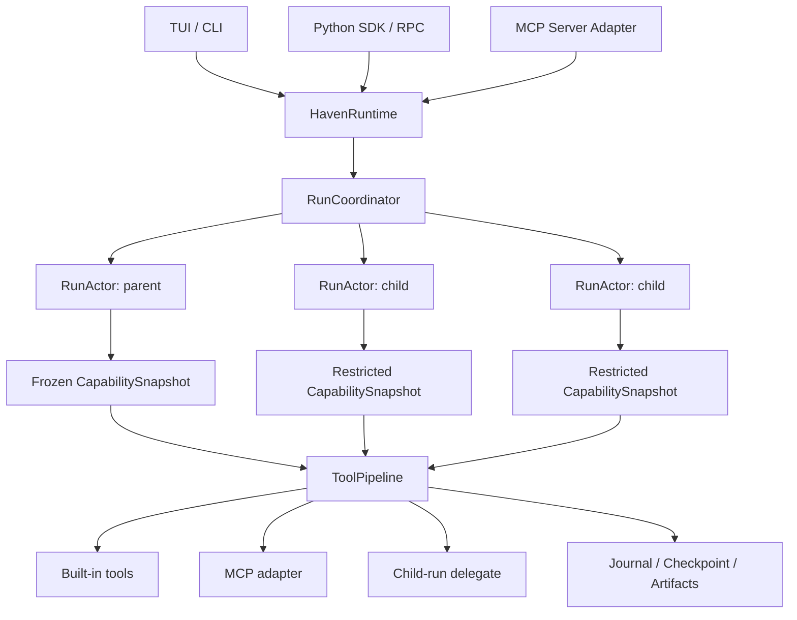

# Haven 未来扩展规划书

> 状态：Draft
>
> 日期：2026-08-30
>
> 适用范围：Haven v1 冻结基线之后的候选演进路线

## 1. 执行摘要

Haven 不应沿着“复制一个功能更全的 Pi、Claude Code 或 Codex CLI”的方向扩张。它已经形成了更有辨识度的核心：**模型只能提案，确定性程序掌握权限、执行、证据与恢复**。未来扩展应强化这一定位，将 Haven 演进为一个可以被 TUI、CLI、SDK、MCP Host 和其他 Agent 复用的安全执行内核。

本规划建议遵循以下顺序：

1. 先抽出 `HavenRuntime`、每运行独立的 `RunActor`，以及运行开始时冻结的 `CapabilitySnapshot`。
2. MCP 优先做 **Server**：让 Pi 等外部 Host 把 Haven 当作可审计、可恢复的只读 Agent 使用。
3. MCP Client 先支持用户显式导入 Resource，再支持配置固定、schema 固定的少量工具。
4. 多 Agent 先支持单个、只读、受预算约束的子运行，再支持并行只读委派。
5. 写入型子 Agent 不直接修改共享工作区，只提交 `PatchProposal`，最终仍由父运行走现有审批与原子补丁通道。
6. Skills、Prompt Templates 和观察型事件订阅可以加入；任意进程内 Python 插件不应成为默认扩展机制。

本规划不自动推翻现有 ADR。`docs/adr/0007-subagents-mcp-and-deterministic-review.md`、`0016-extension-boundary.md` 和 `0023-architecture-verdict-from-the-data.md` 的结论继续有效，直到新的任务数据满足其中的重新开启条件。

## 2. 项目定位

### 2.1 一句话定位

**Haven 是一个证据驱动、权限受控、可恢复的本地 Agent Runtime，而不只是另一个 Coding Agent UI。**

### 2.2 差异化价值

Haven 已经拥有以下可复用资产：

- 单一工具执行通道：Registry → Schema → Facts → Policy → Approval → Ticket → Executor。
- digest 绑定的一次性审批和 TOCTOU 重新验证。
- Evidence Gate：模型不能仅凭自然语言宣布任务成功。
- SQLite 事件日志、检查点、执行日志和不确定副作用调和。
- OS 沙箱、工作区路径限制、受保护路径和单写者租约。
- 有界预算、流式输出、取消、卡循环检测和上下文压缩。
- 离线 ScriptedModel、可复现评估和安全门禁。

这些机制比“支持多少 Provider、多少工具、多少插件”更难构建，也是 Haven 不应在扩展中丢失的核心资产。

### 2.3 不追求的定位

未来仍不建议把 Haven 定位成：

- Pi 的 Python 复刻版。
- 插件拥有宿主进程全部权限的通用自动化平台。
- 默认运行多个可以同时写同一工作区的 Agent 群。
- 仅靠模型 Reviewer 判断安全和成功的系统。
- 未经配置和审计即可连接任意 MCP Server 的工具聚合器。

## 3. 当前架构与扩展阻力

### 3.1 当前主链路

```text
User Goal
   ↓
RunService._drive
   ↓
ContextBuilder → ModelPort
   ↓
ToolPipeline
   ├─ ToolRegistry / Schema
   ├─ ToolFactsCollector
   ├─ deterministic Policy
   ├─ ApprovalCoordinator
   ├─ ExecutionTicket
   └─ ToolExecutor / Evidence / Journal
   ↓
Evidence Gate
   ↓
RunOutcome + Checkpoint + Replayable Events
```

### 3.2 MCP 的主要阻力

当前工具集合是编译内置的，工具信息分布在：

- `src/haven/contracts/tools.py`：参数模型、描述和 schema。
- `src/haven/application/registry.py`：名称查找与参数验证。
- `src/haven/domain/policy.py`：工具分类与策略。
- `src/haven/application/tool_facts.py`：事实收集。
- `src/haven/application/approval_cards.py`：审批预览。
- `src/haven/application/tool_execution.py`：执行分发。

这让“新增一个内建工具”非常安全，但让运行时动态发现工具代价很高。MCP Client 若直接把 `tools/list` 结果塞进模型上下文，会破坏工具可枚举、策略完整和恢复时 schema 稳定等现有保证。

### 3.3 多 Agent 的主要阻力

当前 `RunService` 持有：

- `_active_run_id`；
- `_steer_queue`；
- 每运行 scratch 目录；
- 单一 model、pipeline 和预算配置。

因此一个 `RunService` 只适合驱动一个活跃运行。工具调用也刻意串行，以保持审批、preimage 和事件顺序明确。已有 `parent_run_id` 可以作为子运行关系的起点，但目前还没有完整的子运行预算、取消、恢复和权限继承语义。

## 4. 从 Pi Agent 借鉴什么

本规划参考本机仓库 `/Users/diaoyuxuan/pi`，重点参考：

- `packages/coding-agent/README.md`
- `packages/coding-agent/docs/extensions.md`
- `packages/coding-agent/docs/security.md`
- `packages/coding-agent/examples/extensions/subagent/`
- `packages/agent/docs/harness-v2.md`

### 4.1 值得借鉴

1. **运行时与产品界面分离。** Pi 将模型层、Agent Core、Coding Agent、TUI、协议和存储拆成不同责任边界。Haven 不必拆成多个发布包，但应提供不依赖 TUI 的稳定 Runtime 门面。
2. **区分 Skill、Command、Tool 和 Hook。** 不同扩展不应都被实现成模型工具。
3. **资源发现与应用分离。** 先发现并展示来源、冲突和权限，再决定是否启用。
4. **子 Agent 使用独立上下文。** 子任务不应复制父运行的全部 transcript。
5. **确定性子会话身份。** Pi 新 Harness 设计中，子会话 ID 可由父会话和 tool call 推导，恢复时可以重新挂接而不是重复创建。
6. **单写者、多 Lane。** 并行运行不等于并行修改共享状态。

### 4.2 不应照搬

Pi 的扩展是拥有宿主进程完整权限的 TypeScript 模块，Pi 核心也明确不提供内置权限系统或沙箱。这是合理但不同的产品取舍。Haven 不应引入以下机制：

- 扩展通过普通 Python import 在 Haven 进程内任意执行。
- 扩展自行决定某项操作是否安全。
- 扩展绕过 EventEmitter 直接写持久化状态。
- 子 Agent 直接继承父进程全部环境变量和凭据。
- 多个 worker 直接写同一个工作区。

Haven 应借鉴 Pi 的扩展体验和分层，而不是复制其信任模型。

## 5. 目标架构



### 5.1 HavenRuntime

`HavenRuntime` 是面向 CLI、TUI、SDK 和 MCP Server 的应用门面，建议提供：

```text
start_run(goal, mode, profile) -> run_id
continue_run(run_id, follow_up) -> child_or_followup_run_id
resume_run(run_id)
steer(run_id, text)
cancel(run_id)
approve(run_id, approval_id, decision)
subscribe(run_id) -> event stream
get_snapshot(run_id)
close()
```

Runtime 不拥有具体 UI，也不向调用方暴露 Workspace、Executor 或原始数据库对象。

### 5.2 RunCoordinator 与 RunActor

- `RunCoordinator` 管理运行索引、父子关系、全局预算和单写者规则。
- 每个 `RunActor` 独立拥有 steering queue、scratch、ContextBuilder、StuckLoopDetector 和当前运行状态。
- 一个 RunActor 同时只驱动一个模型操作。
- 多个只读 RunActor 可以并行。
- 同一工作区任何时刻最多一个 RunActor 获得写能力。

### 5.3 CapabilityCatalog 与 CapabilitySnapshot

当前“编译内置并可枚举”的不变量应演进为：

> 内建能力编译内置；外部能力必须显式配置、完成分类、固定摘要，并在一次运行开始时冻结。运行期间不能静默增删或改变 schema。

建议每项能力至少记录：

| 字段 | 含义 |
|---|---|
| `capability_id` | 全局稳定名称，例如 `repo.read`、`mcp.github.get_issue` |
| `origin` | `builtin`、`mcp`、`child_agent` |
| `version` | 内建版本或外部协议/适配器版本 |
| `input_schema` | 提供给模型并用于本地验证的 schema |
| `schema_digest` | 规范化 schema 摘要 |
| `effect_class` | `state`、`workspace_read`、`workspace_effect`、`external_observation`、`external_effect`、`exec` |
| `replay_policy` | `safe`、`idempotent_with_key`、`never` |
| `approval_policy` | `allow`、`ask`、`deny` 的允许范围；最终决定仍由 domain policy 产生 |
| `provenance` | 内建模块、MCP Server 配置或 Agent profile 来源 |
| `result_limits` | 最大字节、内容类型、超时和截断规则 |

运行开始时生成 `CapabilitySnapshot` 和 `catalog_digest`，并写入：

- `run.created` 事件；
- request envelope；
- ExecutionTicket；
- checkpoint；
- export/replay 元数据。

恢复时发现 catalog 或 schema 不一致，应失败关闭并要求创建新运行。

## 6. MCP 发展规划

MCP 当前版本仍在快速演进。本规划以官方 `2026-07-28` 版本为目标版本；实现必须使用固定版本的官方 Python SDK，并通过 Haven 自己的契约测试封装，不能让 SDK 类型渗透进 domain/application。

官方参考：

- <https://blog.modelcontextprotocol.io/posts/2026-07-28/>
- <https://modelcontextprotocol.io/specification/draft/server/tools>

### 6.1 为什么先做 MCP Server

MCP Server 属于新的 interface adapter，不要求 Haven 接受动态工具，因此对核心不变量影响最小。它还可以形成一个清晰的项目展示：

```text
Pi Agent
  → Pi extension / MCP client
  → haven mcp serve --stdio
  → Haven read-only run
  → structured result + run_id + evidence + replay
```

这让 Pi 提供模型生态和灵活交互，让 Haven 提供有界执行、持久化与证据，两者形成互补关系。

### 6.2 MCP Server MVP

建议命令：

```text
haven mcp serve --stdio --workspace PATH --read-only
```

工作区必须由启动者固定，不能由模型在 tool 参数中任意选择。

第一版暴露：

#### Tools

| 名称 | 作用 | 限制 |
|---|---|---|
| `haven.run_readonly` | 启动有界只读运行 | 固定工作区、固定 Provider profile |
| `haven.continue_readonly` | 延续既有运行 | 必须匹配 workspace digest |
| `haven.cancel_run` | 取消当前运行 | 仅能取消本 server 创建的运行 |

#### Resources

| URI | 内容 |
|---|---|
| `haven://runs/{run_id}` | 状态、停止原因、预算和使用量 |
| `haven://runs/{run_id}/events` | 已脱敏的持久化事件 |
| `haven://runs/{run_id}/diff` | 本次运行 diff；只读 MVP 通常为空 |
| `haven://runs/{run_id}/evidence` | Evidence Ledger 摘要 |
| `haven://runs/{run_id}/export` | 可分享的 Markdown/JSONL 导出 |

第一版明确不支持：

- 写模式；
- 任意 repo 工具透传；
- Streamable HTTP；
- OAuth；
- MCP Apps；
- Tasks 扩展；
- Server 发起模型 sampling；
- 读取任意本机路径。

### 6.3 MCP Client 阶段

#### 阶段 C1：显式 Resource 导入

由用户而不是模型选择 Resource：

```text
haven context add <server-id> <resource-uri>
```

资源内容：

- 作为不可信 Context 加入；
- 带 server、URI、抓取时间和内容 digest；
- 受单资源和总上下文大小上限约束；
- 不获得任何权限提升；
- 默认不在运行期间自动刷新。

#### 阶段 C2：单 Server、少量 allowlist 工具

初始配置只允许出现在用户级配置，项目 `.haven.toml` 不能自动启动 MCP Server。

示意配置：

```toml
[mcp.servers.issue_context]
transport = "stdio"
argv = ["approved-mcp-server", "--stdio"]
protocol_version = "2026-07-28"
tool_allowlist = ["get_issue", "search_issues"]
schema_digest = "sha256:..."
allow_network = true
timeout_seconds = 30
max_result_bytes = 65536
```

工具在模型侧使用带命名空间的名称：

```text
mcp.issue_context.get_issue
mcp.issue_context.search_issues
```

不能依赖 MCP Server 自报名称解决冲突，也不能信任 `readOnlyHint`、`destructiveHint` 或 `idempotentHint`。这些信息只用于展示；Haven 的 effect/replay 分类来自用户固定配置和本地策略。

#### 阶段 C3：远程 MCP

只有 C2 证明有净收益后才考虑：

- Streamable HTTP；
- OAuth/CIMD；
- 凭据生命周期；
- TLS 和授权服务器身份绑定；
- Tasks 扩展；
- 长期连接或订阅。

凭据只能来自用户配置指定的环境变量或平台凭据存储，不能来自项目文件、模型参数或事件日志。

### 6.4 MCP 调用与恢复语义

外部 MCP Server 的真实副作用无法通过工作区 preimage/postimage 判断，因此必须增加外部效果类别：

| 类型 | 默认策略 | 中断后处理 |
|---|---|---|
| 显式 Resource 读取 | 用户触发、允许 | 可以重新读取，但记录新 digest |
| MCP observation tool | `ASK` | 默认不自动重试；配置声明安全后才允许 |
| MCP external effect | `ASK` | `EFFECT_UNKNOWN`，必须人工 reconcile |
| MCP workspace effect | 初期 `DENY` | 不支持 |

MCP ToolResult 必须经过：

1. 协议与内容类型验证；
2. output schema 验证（若提供）；
3. 大小、深度和验证耗时限制；
4. 控制字符与展示编码处理；
5. `<tool_output>` 不可信包装；
6. 事件摘要与完整 artifact 分离；
7. 敏感信息导出脱敏。

## 7. 多 Agent 发展规划

### 7.1 目标

多 Agent 只解决下列已经被测量的问题：

- 一个任务包含可独立并行调查的多个子问题；
- 父 Agent 上下文被大量探索信息挤占；
- 大型仓库中需要不同搜索假设交叉验证；
- Reviewer 在真实 diff 上显著提高缺陷发现率。

多 Agent 不用于掩盖单 Agent 不会停止、重复搜索或无法理解一个已经局部化问题的情况。

### 7.2 第一阶段：单个只读子 Agent

新增一个静态内建工具：

```text
agent.delegate
```

建议参数：

```text
role               scout | reviewer
task               有界子任务
file_scope         可选路径白名单
max_steps          小于父运行剩余预算
max_tool_calls     小于父运行剩余预算
max_input_tokens   小于父运行剩余预算
max_output_tokens  小于父运行剩余预算
```

第一版约束：

- 深度固定为 1；子 Agent 不能再委派。
- 同时最多一个子 Agent，先验证语义再增加并发。
- 工具仅允许 `repo.list/search/read/diff` 和确定性安全的只读能力。
- 子 Agent 不能请求写审批。
- 子 Agent 不继承父 transcript，只接收目标、项目规则、文件范围和必要 artifact。
- 子 Agent 输出被视为不可信 observation。

### 7.3 子运行身份与持久化

建议关系字段：

```text
root_run_id
parent_run_id
spawn_call_id
child_index
role
capability_snapshot_digest
budget_allocation
```

子运行 ID 应确定性派生：

```text
child_run_id = hash(parent_run_id, spawn_call_id, child_index)
```

这样可以保证：

- 父进程在收到子结果前崩溃，恢复时重新挂接同一个子运行；
- 不会因重放 `agent.delegate` 创建重复子运行；
- export 可以打包完整父子关系；
- 成本和 token 可以归因到根任务、父运行和子运行。

建议新增事件：

```text
child.proposed
child.started
child.progressed
child.finished
child.cancelled
child.reattached
```

### 7.4 层级预算

根运行预算是唯一权威：

```text
root_usage = parent_usage + Σ child_usage
```

规则：

- 创建子运行前预留最大额度；可用额度不足则拒绝。
- 子运行不能提高模型、时间、步骤、工具或费用上限。
- 子运行完成后，未使用额度可以重新变为可分配额度；实际消耗永久计入根运行。
- 并行子运行的最大分配总和不能超过根运行剩余额度。
- Provider 返回 usage 前的估算和最终 usage 都要纳入根预算，不能只在子运行结束后一次性补记。

### 7.5 结构化子 Agent 输出

Scout 输出建议采用：

```json
{
  "answer": "...",
  "evidence": [
    {"path": "src/example.py", "line": 42, "content_digest": "sha256:...", "claim": "..."}
  ],
  "unresolved": ["..."],
  "confidence": "low|medium|high"
}
```

父运行使用引用前重新检查文件 digest；过期引用标记为 stale，而不是继续当成事实。

Reviewer 输出只能产生 finding：

```text
severity
path / line
finding
evidence
suggested_fix
```

Reviewer 不得直接把运行判定为成功或失败。确定性 Evidence Gate 继续是最终权威。

### 7.6 第二阶段：并行只读子 Agent

满足以下前提后再开启：

- `RunActor` 已经完成每运行状态隔离；
- Memory/SQLite store 的并发契约测试通过；
- 事件顺序明确区分全局序号和子运行局部序号；
- 取消能够从父运行传播到所有子运行；
- 根预算可以在并发计费时失败关闭；
- 子运行只读，不参与工作区写租约竞争。

建议上限：

- 最大 fan-out：3；
- 最大深度：1；
- 默认并发：2；
- 结果按模型原始任务顺序交付，UI 进度可按完成顺序展示。

### 7.7 第三阶段：PatchProposal Worker

写入型子 Agent 不直接调用 `repo.edit/create/delete/move/apply_patch`。它只能返回：

```text
PatchProposal
  operations
  summary
  evidence references
  expected files
  base digests
```

父运行负责：

1. 重新读取和验证 base digest；
2. 模拟完整补丁；
3. 展示一次审批卡；
4. 通过当前 `repo.apply_patch` 原子执行；
5. 记录 diff 与 check；
6. 进入 Evidence Gate。

这样可以并行生成候选方案，但工作区始终保持单写者。

## 8. Skills、Commands、Hooks 与插件边界

建议把扩展类型明确分为四类：

| 类型 | 谁触发 | 是否可执行代码 | 信任与权限 |
|---|---|---|---|
| Skill / Prompt Template | 用户或模型按需加载 | 否 | 不可信 Context，不能改变权限 |
| Command | 用户显式输入 | Haven 内建应用代码 | 只能调用公开 Runtime 用例 |
| Tool / Capability | 模型提议 | 内建或隔离适配器 | 必须经过 ToolPipeline |
| Event Subscriber | 系统事件 | 初期仅进程外观察 | 接收脱敏事件，不得改变执行 |

### 8.1 推荐先做声明式 Skills

Skills 可以提升日常使用体验，又不需要扩大执行权限：

- 用户级目录优先；
- 项目级 Skill 需要 project trust；
- 内容带来源、digest 和作用域；
- 按需加载，不全部塞进 system prompt；
- Skill 中提及的脚本不会自动变成受信工具。

### 8.2 不建议做任意 Python 插件

如果未来确实需要可执行插件，优先使用：

- MCP/stdio 进程边界；
- 固定 argv；
- OS 沙箱；
- 明确网络、环境变量和可读路径；
- 有界输入输出和取消协议。

这比在 Haven 进程中 `import` 第三方插件更符合现有安全模型。

## 9. Provider 与模型角色

多 Agent 不必立即引入完整多 Provider 路由。建议顺序：

1. 将 `ModelPort` 的构造从单个实例提升为受控的 `ModelFactory`。
2. Agent profile 可以选择同一 OpenAI-compatible endpoint 上的不同模型。
3. 记录每个角色实际模型、费率、能力和上下文上限。
4. 在同 Provider 多模型稳定后，再评估第二种 wire adapter。

第一版角色示例：

| 角色 | 模型倾向 | 权限 |
|---|---|---|
| Parent | 当前默认模型 | 当前运行权限 |
| Scout | 低成本、低延迟模型 | 只读 |
| Reviewer | 更强推理模型 | 只读 diff/artifact |
| Patch Worker | 默认或更强模型 | 只产出 PatchProposal |

自动模型路由不能只依据模型自报能力；需要 profile、定价、上下文和真实评测共同决定。

## 10. 评估与准入门禁

### 10.1 总原则

- 先写失败分类和采用阈值，再实现功能。
- 单 Agent 基线与新方案使用相同任务、模型版本、总预算和成功 oracle。
- 离线测试证明协议、安全和恢复；真实模型评估证明收益。
- 任何安全违规都覆盖任务成功率，不能用平均分掩盖。

### 10.2 MCP 离线测试矩阵

Fake MCP Server 至少覆盖：

| 类别 | 用例 |
|---|---|
| 发现 | 空工具表、重复名称、非法名称、顺序变化 |
| Schema | digest 一致、schema drift、过深 schema、外部 `$ref`、验证超时 |
| 身份 | argv 改变、endpoint 改变、自报 serverInfo 改变、协议降级 |
| 结果 | 超大文本、非法 JSON、错误 output schema、图片/资源链接、控制字符 |
| 注入 | tool description 注入、ToolResult 注入、Resource 内容注入 |
| 生命周期 | 超时、取消、server 崩溃、半响应、重连 |
| 效果 | observation、external effect、未知效果与 reconcile |
| 凭据 | env 不入日志、不入 Context、不入 export |
| 恢复 | schema 不变可恢复、schema 改变失败关闭 |

准入要求：

- 所有安全与恢复用例通过；
- 0 个未经批准的外部调用；
- schema/身份漂移 100% 失败关闭；
- oversized 和 injection 内容不会突破上下文或权限边界；
- replay/export 不泄露凭据。

### 10.3 MCP 收益评估

必须先指定一个 Haven 仅凭本地仓库无法完成的任务类，例如：

- issue/PR 上下文不在 checkout 中；
- 内部文档或 API catalogue 不在仓库中；
- CI/缺陷平台中的只读状态查询。

建议最小实验：

- 不少于 12 个任务；
- 至少 3 种不同外部上下文形态；
- 比较“无 MCP”“显式 Resource”“MCP Tool”三组；
- 记录成功率、步骤、token、费用、延迟、审批次数和注入行为。

若 Resource 导入已经达到相同成功率，不继续增加模型自主 Tool 调用。

### 10.4 多 Agent 收益评估

任务必须具有真实可分解性，而不是普通单点 bug。建议：

- 不少于 20 个任务；
- 至少 3 个仓库；
- 相同根预算；
- 单 Agent、单只读子 Agent、并行只读子 Agent三组对比；
- Reviewer 单独评估 defect detection、false positive、成本和延迟。

建议在实验前通过 ADR 固定具体阈值。默认候选阈值：

- 任务成功率至少提升 10 个百分点，或在不降低成功率的情况下将中位步骤降低 20%；
- 总成本不高于单 Agent 的 1.8 倍；
- 0 个新增安全违规；
- 0 个并发写覆盖；
- 所有子运行都可取消、重放和归因；
- 收益至少分布在 3 个任务上，不能由一个异常任务贡献全部提升。

## 11. 分阶段交付路线

| 阶段 | 目标 | 主要交付物 | 规模 | 进入下一阶段条件 |
|---|---|---|---|---|
| P0 | 重新开启决策 | 新 ADR、失败语料、预注册门禁 | S | 明确命名任务与采用阈值 |
| P1 | Runtime 基础 | `HavenRuntime`、`RunActor`、无行为变化测试 | M | 现有 golden trace、fast gates、offline eval 不变 |
| P2 | 能力快照 | `CapabilityCatalog/Snapshot`、digest、恢复校验 | M | 静态 12 工具行为完全兼容 |
| P3 | MCP Server | stdio、只读 run、resources、Pi 演示扩展 | M | 协议/取消/导出测试通过 |
| P4 | MCP Resource Client | 用户显式导入、大小与 trust 标签 | M | 命名任务显示净收益 |
| P5 | 单只读子 Agent | `agent.delegate`、父子事件、层级预算 | M-L | A/B 满足预注册门禁 |
| P6 | MCP Tool Client | 单 server、allowlist、schema pin、fake server | L | 资源导入不足且工具有净收益 |
| P7 | 并行只读 Agent | RunCoordinator、fan-out、取消与恢复 | L | 单子 Agent 已证明收益 |
| P8 | PatchProposal Worker | 隔离生成、父运行原子应用 | L | 只读编排稳定且写任务有明确收益 |

`S/M/L` 表示相对工程规模，不是日历承诺。

### 11.1 推荐的首个纵向切片

建议第一个展示闭环只做：

```text
Pi extension
  → 调用 Haven MCP Server
  → 启动 read-only Haven run
  → Pi 展示实时进度
  → 返回 answer + run_id + evidence URI
  → 用户可在 Haven replay 中复核
```

该切片同时证明：

- Pi 与 Haven 的互补定位；
- MCP 接口适配；
- Runtime 可嵌入；
- 事件流和取消；
- 结果可审计；
- 没有引入动态执行工具或并发写。

## 12. 预计代码落点

以下只是模块规划，实施前应通过 ADR 和具体设计再确认：

| 位置 | 候选变化 |
|---|---|
| `src/haven/application/run_service.py` | 拆出每运行 `RunActor`，保留循环语义 |
| `src/haven/application/runtime.py` | 新增稳定应用门面 |
| `src/haven/application/run_coordinator.py` | 父子运行、预算、取消和单写者协调 |
| `src/haven/application/registry.py` | 从全局静态表演进为冻结 snapshot 校验 |
| `src/haven/application/tool_pipeline.py` | 消费 capability descriptor，但不放宽执行阶段 |
| `src/haven/contracts/capabilities.py` | descriptor、snapshot 和 digest DTO |
| `src/haven/contracts/events.py` | capability 和 child run 事件 |
| `src/haven/contracts/checkpoint.py` | snapshot digest、父子关系和迁移版本 |
| `src/haven/domain/policy.py` | 新 effect class；仍保持纯函数 |
| `src/haven/domain/budget.py` | 根预算与子分配规则 |
| `src/haven/ports/model.py` | 可选 ModelFactory |
| `src/haven/ports/session.py` | 父子查询、运行关系和 capability snapshot |
| `src/haven/ports/mcp.py` | MCP transport/client port，避免 SDK 泄漏到应用层 |
| `src/haven/adapters/mcp/` | 官方 SDK 适配器、stdio/未来 HTTP |
| `src/haven/interfaces/mcp_server.py` | MCP Server interface adapter |
| `tests/fakes/` | Fake MCP Server 与可控并发环境 |

不建议因为参考 Pi 就立即把 Haven 拆成多个独立 Python package。当前 import-linter 分层已经足够明确；只有出现真正独立发布和复用需求时再拆包。

## 13. 风险清单

| 风险 | 影响 | 缓解方式 |
|---|---|---|
| 功能扩展稀释安全主张 | 项目失去差异化 | 所有扩展继续经过单一执行通道和 Evidence Gate |
| MCP schema 运行时变化 | 审批与恢复不再绑定同一操作 | schema digest、运行冻结、漂移失败关闭 |
| MCP Server 自报只读但实际写入 | 外部未授权副作用 | annotation 不可信；用户分类；初期 deny/ask |
| 外部凭据进入 Context 或日志 | 密钥泄漏 | env/credential store；DTO 中不保存值；export 回归测试 |
| 子 Agent 预算放大 | 成本和时间失控 | 根预算聚合、启动前预留、每角色上限 |
| 子 Agent 权限升级 | 越权执行 | capability subset；父权限不可被子角色扩大 |
| 并行读到不同工作区状态 | 结论过期 | workspace snapshot/digest；引用使用前重新验证 |
| 多 worker 覆盖文件 | 变更丢失、恢复歧义 | 子 Agent 不直接写；父运行单写者应用 PatchProposal |
| Reviewer 被当作权威 | 模型意见替代证据 | finding 仅 advisory；Evidence Gate 继续决定成功 |
| 动态插件绕过日志 | 无法审计与恢复 | 不支持任意进程内插件；使用 MCP/stdio 隔离 |
| 新事件破坏三个 renderer | TUI/CLI/export 漂移 | 增加事件渲染完整性测试 |

## 14. 建议新增的 ADR 主题

实施时建议分别记录，不在本规划中预占 ADR 编号：

1. Runtime facade 与每运行状态隔离。
2. CapabilitySnapshot：从编译内置到配置固定、运行冻结。
3. Haven 作为 MCP Server 的信任与交互边界。
4. MCP Client 的身份、schema、授权和恢复语义。
5. 子运行身份、层级预算和取消传播。
6. 并行只读运行与单写者不变量。
7. PatchProposal Worker 与父运行提交协议。
8. 声明式 Skills 和 project trust。

每篇 ADR 都应包含：问题、基线、选项、采用门禁、数据、决定、后果和回滚方案。

## 15. 完成定义

一项扩展只有同时满足以下条件才算完成：

- 有明确命名的失败类型或用户任务，而不是只增加功能数量。
- 有实现前固定的收益和安全门禁。
- 新能力在运行开始时可枚举、可显示、可固定摘要。
- 所有模型提议仍进入 ToolPipeline。
- 所有副作用仍有 policy、approval、ticket、journal 和恢复语义。
- 子 Agent 或 MCP Server 无法扩大父运行权限。
- 中断、取消、超时、schema drift 和 oversized output 有测试。
- TUI、CLI、JSONL、export 和 replay 对新增事件有明确处理。
- 先运行 focused tests，再运行：

  ```bash
  uv run python scripts/gates.py --mode fast
  uv run pytest -q
  uv run haven eval --offline
  ```

- 实验数据满足预注册门禁，并通过新 ADR 正式替代旧的 deferred 决定。

## 16. 最终建议

如果 Haven 继续作为求职作品和 Agent 工程教学基线，建议完成到 P3 或 P5：一个可复用 Runtime、一个只读 MCP Server、一个受限只读子 Agent，已经足以展示清晰的未来架构，同时保留当前项目最有说服力的范围控制。

如果 Haven 转向长期产品，则继续推进 MCP Client、并行只读 Agent 和 PatchProposal Worker，但默认配置仍应保持单 Agent、固定工具、显式审批；扩展能力以 profile 或实验开关逐步开放，而不是一次性改变现有 CLI/API 合同。

最重要的判断不变：**Haven 的目标不是让模型能做更多未经控制的事，而是让更多模型、工具和 Agent 都只能在可解释、可授权、可恢复的边界内做事。**
