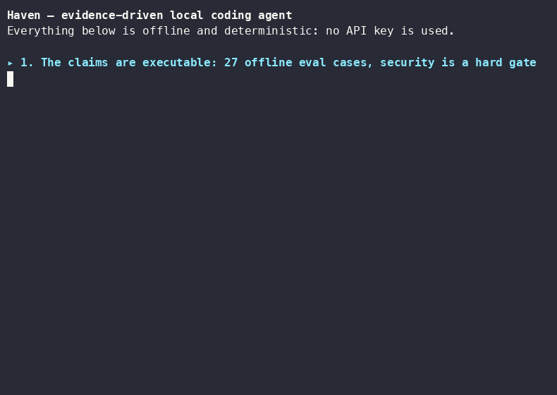
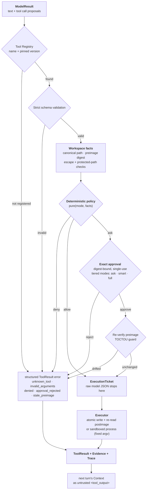

# Haven

**English** | [中文](README.zh-CN.md)

**An evidence-driven, replayable, locally scoped TUI coding agent.** The model
proposes actions; the program enforces policy, approval, execution, and success
criteria. Haven is a from-scratch implementation of the machinery behind a
production coding agent (à la Claude Code / Codex CLI) — a bounded agent loop, a
single audited tool-execution channel, precise human approval, durable recovery,
and a reproducible offline eval suite — without leaning on an agent framework.

> Value proposition: a coding agent where a non-deterministic model can only ever
> *propose*; deterministic code owns permission, execution, and the definition of
> success.



*The full offline tour (`./scripts/demo.sh`) — deterministic eval with its
security gate, config provenance, context inspection, and `doctor`; no API
key needed. The interactive TUI walkthrough is scripted in `docs/DEMO.md`.*

## What it does

In a local Git repository you give Haven a bounded coding task. The agent
searches and reads code, proposes a precise edit, waits for your approval, applies
it atomically, runs a registered verification recipe, and shows the streaming
answer, tool trace, diff, test evidence, budgets, and a single stop reason — all
in the terminal. Runs are checkpointed, recoverable, replayable, and gradeable.

```text
Open a local Git repo
  → enter a coding task
  → agent searches, reads, and plans
  → agent proposes a precise edit
  → TUI shows the diff, risk, and one-time approval scope
  → you approve or reject
  → executor applies the change and runs a fixed verification recipe
  → agent may fix failures within a bounded budget
  → TUI shows the final diff, tests, cost, trace, and stop reason
```

## Quick start (offline, no API key)

For a runtime-only install, platform checks and session upgrades, see the
[installation and upgrade guide](docs/INSTALL_UPGRADE.md).

```bash
uv sync --locked

# Run the deterministic eval suite (ScriptedModel; no network, no key)
uv run haven eval --offline          # all cases pass, 0 security violations
uv run python evals/generate_cases.py  # regenerate case JSON if you edit them

# Inspect a stored run / replay its timeline
uv run haven sessions list
uv run haven replay <RUN_ID>

# See exactly where every config value comes from
uv run haven config explain

# See what the model would be shown for a task, and why
uv run haven debug-context "fix the failing parser test"
```

The default provider is OpenAI-compatible. For a live run, set a key and launch
the TUI:

```bash
export HAVEN_API_KEY=sk-...
export HAVEN_MODEL=gpt-4o-mini        # optional; overrides the default
uv run haven verify-provider --yes    # one tiny real request to check connectivity
uv run haven                          # interactive TUI in the current repo
```

Any OpenAI-compatible Chat Completions endpoint that supports streaming and
tool calls can be configured; point `HAVEN_API_KEY_ENV` at whatever variable
the provider conventionally uses:

```bash
export DEEPSEEK_API_KEY=sk-...
export HAVEN_API_KEY_ENV=DEEPSEEK_API_KEY
export HAVEN_BASE_URL=https://api.deepseek.com/v1
export HAVEN_MODEL=deepseek-v4-flash
```

## The single execution channel

Every model-proposed action passes through one pipeline; there is no other path
from a model proposal to a side effect. Each exit on the left produces a
*structured* `ToolResult` that is fed back to the model — never a raw exception.



See `docs/ARCHITECTURE.md` for the layering and state-machine diagrams, and
`docs/SECURITY.md` for the trust model and the guarantees each stage provides.

## What this project demonstrates

- A custom provider adapter, tool-calling layer, and **bounded agent loop** with a
  single, explicit stop reason for every run — not a prebuilt framework.
- Clear separation of **State ≠ Context ≠ Trace ≠ ModelResult**, enforced by an
  import-contract'd layering (`domain → application → ports`, adapters behind a
  single composition root).
- A `search → read → edit → verify → diff` loop over a real repository.
- **Deterministic policy + digest-bound one-time approval** (with tiered modes: `ask`, `smart`, `full`), hard path
  confinement for file tools, and mandatory native-sandbox confinement for
  model-proposed general exec, with TOCTOU and stale-approval protection.
- An **Evidence Gate**: a run that edited files cannot succeed on the model's word;
  it needs a diff and a passing check recorded *after* the last write, and a
  deterministic review of what it wrote (no committed secrets, conflict markers,
  debugger statements, or silently blanked files). A **read-only** run has no
  artifact to check an answer against, so it is bounded by budgets and stop
  reasons rather than verified — the limit is stated in ADR 0003.
- **Durable execution**: SQLite checkpoint + append-only event journal, with
  recovery that classifies interrupted effects and *never auto-replays* an
  ambiguous one.
- Streaming, cancellation, budgets (steps/tools/time/tokens/cost), and
  stuck-loop detection.
- A **reproducible offline eval suite** spanning task, robustness, security,
  injection, budget, and recovery cases (count in the generated table above)
  with JSON + Markdown reports and a hard security gate.
- Read-only scout/reviewer model loops with independent context and parent budget
  accounting, structured plans with dependencies and evidence, controlled MCP
  tools, and explicit worktree review. Historical feature tradeoffs are recorded
  in ADR 0007 and ADR 0023; current behavior is described in
  [capabilities](docs/REMAINING_CAPABILITIES.md).

## Non-goals (v1)

Unrestricted multi-agent orchestration · RAG/GraphRAG · browser/computer-use/voice/image ·
cloud accounts or remote execution · an unconfined shell (`repo.exec` is argv
only; an explicit shell interpreter always asks and stays sandboxed) · auto
commit/push/PR · multi-provider routing. These are deliberately out of
scope so the core guarantees can be proven rather than gestured at.

## Command surface

<!-- BEGIN CLI COMMAND SURFACE -->

```text
haven                                # interactive TUI in the current directory
haven tui [PATH]                     # interactive TUI in an explicit workspace
haven init --workspace PATH [--accept]   # one-step onboarding: env summary + recipe discovery
haven run GOAL --workspace PATH      # headless; read-only by default
haven run GOAL --write --approval-policy reject|trusted-recipe|all [--jsonl] [--events F]
haven run GOAL --skill NAME          # load a discovered skill (repeatable)
haven run GOAL --plan                # prepare a read-only plan for review
haven run GOAL --write --worktree --review   # retain verified changes for human review
haven review RUN_ID [--file PATH --hunk N]   # browse retained changes without a model
haven review RUN_ID --apply|--discard --binding DIGEST   # resolve the reviewed snapshot
haven implement RUN_ID --approval-policy reject|trusted-recipe|all   # confirm a ready plan
haven answer RUN_ID --request ID --answers '{"scope":"Parser"}'  # answer a saved question
haven continue RUN_ID FOLLOW_UP      # a follow-up turn that keeps prior context
haven skills list | init | info | validate   # manage, scaffold, inspect, and check skills
haven mcp list | inspect | pin | serve SERVER_NAME   # manage and pin controlled MCP servers
haven context list | add | remove SERVER_NAME RESOURCE_URI  # manage imported context resources
haven discover --workspace PATH [--accept]   # suggest (or persist) .haven.toml recipes
haven doctor --workspace PATH        # environment check, no side effects
haven gc [--keep N] [--older-than-days D] [--yes]   # prune old runs (dry run by default)
haven sessions list | show RUN_ID
haven sessions list --search QUERY   # search full history by ID, goal or status
haven replay RUN_ID                  # pure journal projection, no model/tools
haven resume RUN_ID                  # recovery checks, then TUI
haven rewind RUN_ID                  # undo a finished run's file changes (fail-closed)
haven reconcile RUN_ID CALL_ID --as confirmed|not_run|abandon
haven export RUN_ID --format jsonl|markdown
haven output RUN_ID [CALL_ID]        # check status, diagnostic locations and saved process logs
haven handoff RUN_ID [--prepare|--set FILE --expected-seq N|--history|--clear]
haven debug-context GOAL             # what the model would see, and why
haven debug-context --run RUN_ID     # the context recorded at each step
haven eval --offline [--category task,security]
haven eval --live --yes              # explicit, paid, not reproducible
haven verify-provider --yes          # explicit, may incur provider cost
haven config explain --workspace PATH
```

<!-- END CLI COMMAND SURFACE -->

Inside the TUI, `/help`, `/mode`, `/budget`, `/context`, `/new`, `/sessions`, `/skill`,
`/fork`, `/rewind`, `/diff`, `/review`, `/export`, and `/quit` expose the interactive controls.
`/sessions` opens a searchable picker to open history, resume an interrupted task,
or fork it. `/new` starts a fresh conversation. `/diff` browses files and hunks.
Isolated TUI changes require confirmation before reconciliation; `/review` reopens
a retained review. Pending questions and reviews block starting another task.
Managed processes accept stdin through `task.input`; `task.start(terminal=true)`
uses a POSIX PTY. See [capabilities](docs/REMAINING_CAPABILITIES.md) for tools and limits.
Use `/plan` with a goal to prepare a read-only plan, review or revise it in chat, then
explicitly confirm with `/implement` (or `/implement RUN_ID`). Ordinary follow-ups
and `/mode` approval changes keep planning read-only. See [Plan mode](docs/PLAN_MODE.md)
for the runtime API and persistence guarantees.
When the agent needs clarification, the TUI displays a form; `/answer` reopens it.
Headless runs return `needs_input` with exit code `8` and save the question for
`haven answer`. Answers resume the same run with its budget and evidence intact.
See [User input](docs/USER_INPUT.md) for cancellation, JSON, and worktree recovery.
`@path` file mentions point the agent at a file without bypassing `repo.read`;
typing while a run is active queues the input for the next turn rather than
interrupting it.

Exit codes are stable: `0` success · `2` usage · `3` policy/permission ·
`4` provider · `5` tool · `6` budget/stopped · `7` recovery required · `8` needs input.

In the main TUI input, Up/Down recalls the last 20 submitted task prompts.
Down past the newest entry restores the draft you were writing before browsing.
History is saved per workspace in the existing session database and restored on
restart; drafts stay in memory. Slash commands and question-form answers are not
added to this history.
Use `/history` to view it, or `/history clear` to remove only this workspace's
input history. These commands preserve a draft saved while browsing history.
Use `/memory` to inspect the loaded guidance for new runs, with source,
scope, missing/unavailable files, and truncation details. It shows the loaded
snapshot without reading files again or calling the model.
Use `/memory reload` while idle to load external edits for the next run or follow-up.
Active tasks, pending questions and pending reviews block reload. Resuming a saved
task uses its own guidance snapshot; older checkpoints without a snapshot warn and
use the current guidance. Reload reads the active workspace (the isolated worktree
when enabled) and leaves permissions, skills, recipes and MCP configuration unchanged.
Use `/remember` followed by the note text while idle to save it in Haven's local user data.
`/memory` lists its ID and creation time; `/memory forget ID` deletes one note and
`/memory clear` clears this project's notes. Limits are 20 notes, 500 characters
per note and 2000 text characters in total; reaching a limit rejects the new entry.
Notes are separate from repository guidance and enter new runs as untrusted data.
They persist across restarts and isolated worktrees for the same main workspace.
Deleting notes leaves historical task snapshots intact. Note edits do not re-read
repository guidance; use `/memory reload` for external file changes.

Use `/verify` to inspect configured verification groups and current results.
`/verify use NAME` selects required checks for the next run; `/verify clear`
explicitly clears that next selection. Headless runs accept `--check-group NAME`;
follow-ups inherit the saved selection unless explicitly changed or cleared.
Every selected check must pass with its configured command after the last write.
Missing, failed, stale or filtered results cannot satisfy it. See
[verification groups](docs/VERIFICATION_GROUPS.md) for configuration, approvals,
Plan mode, recovery and `--clear-check-group`.

For a Python project using pytest and Ruff, see the
[Python workflow](docs/PYTHON_WORKFLOW.md): preview and confirm fixed recipes,
inspect their environment and permissions, then verify and review an isolated change.
`doctor` reports missing pytest/Ruff modules when the recipe uses Haven's Python environment;
other interpreters are explicitly reported as unverified.

The Evidence tab now groups required-check states with recent process results,
diagnostic locations and saved-output commands. `/output` opens that tab;
`/output CALL_ID` opens a paginated log without a model call. Headless users can
use `haven output RUN_ID` for an overview, or add `CALL_ID` to read the saved log.
See [process output](docs/PROCESS_OUTPUT.md) for capture limits, paging and export.

Use `/handoff` to review a task's ledger facts and saved working notes;
`/handoff prepare`, `/handoff edit`, `/handoff history` and `/handoff clear`
maintain an explicit record while a task is paused or finished. Notes preserve
decisions, attempts and next steps across compaction and recovery; they remain
untrusted context. Required checks are always calculated from the ledger.
The question dialog's **Keep paused** button returns to the main view without
consuming an answer; `/answer` reopens it. See [task handoff](docs/HANDOFF.md).

Use `/model` to inspect presets and the last call, and `/model use NAME` to
choose a preset for new runs. Headless runs accept `--model-preset NAME`.
Saved runs resume with their original route. See [model presets](docs/MODEL_PRESETS.md).

Use `/stats` or `haven sessions stats RUN_ID` to inspect a run's recorded model
and tool times, repeated read ranges, context builds, tokens, and estimated cost.
The slowest calls include event numbers for lookup in a JSONL export. Tool times
include approval wait. Context compression counts builds that recorded a digest
or a budget truncation. Reports for ongoing runs use the events available so far.

Task completion, failure, and requests for your input ring the terminal bell in
the TUI and interactive human-readable headless runs. Set `HAVEN_BELL=0` to disable
the sound; terminal settings control whether it is audible or visual. Redirected
output, JSON output, replay, and delegated child completions do not ring.
Common credential, verification-recipe, and permission errors include a next-step
hint. Run the suggested configuration commands in the task's workspace.

## Development

```bash
uv sync --locked
uv run python scripts/gates.py --mode fast   # format, lint, types, layering, docs, notes
uv run python scripts/gates.py               # everything CI enforces
uv run python scripts/gates.py --list        # the gate graph and its dependencies
```

The gates are declared once in `scripts/gates.py` with their dependencies, and
CI runs the same graph (`--mode full`), so the local command list and the CI
steps cannot drift apart. Tests are fully offline and deterministic: `ScriptedModel`
is the default model, and no test touches the network or a real API key.

## Measured results

Offline tests, coverage and evaluations can be reproduced without an API key.
Live-model scores are historical measurements, not re-runs of this version.
The table is generated by `scripts/refresh_metrics.py` and CI checks for drift.
For reports stored outside the workspace, use `--coverage-data PATH` and
`--offline-report PATH`; add `--preserve-historical-live` to keep the existing
historical rows without reading the live results directory. Use the same options
with `--check` to verify the generated table.

<!-- BEGIN GENERATED METRICS (scripts/refresh_metrics.py; do not edit by hand) -->

| Metric | Value |
|---|---|
| Automated tests | 1485 |
| Line coverage (`src/`) | 91% |
| Source / test size | ~30.7k / ~25.8k lines |
| Typed modules (`mypy --strict`) | 152 |
| Architecture decision records | 50 |
| Offline eval | 45/45 passed, 0 security violations |
| Eval categories | security 20 · task 10 · robustness 6 · injection 4 · budget 3 · recovery 2 |
| Historical live real-repo suite (deepseek-v4-flash) | 75/79 after fixes (31/31 + 9/9 + 5/5 + 20/20 + 9/13 + 1/1); 0 security violations — as-found runs and root causes in docs/EVAL_LIVE.md |
| Historical same-version full rerun | 61/65 in one uninterrupted run (failure attribution in docs/EVAL_LIVE.md) |

<!-- END GENERATED METRICS -->

Other fixed guarantees: `ruff`, `mypy --strict`, and `import-linter` (3 layering
contracts) gate every commit; the golden trace is stable across runs and TUI
and headless emit identical traces; the live DeepSeek run is written up in
[`docs/EVAL_LIVE.md`](docs/EVAL_LIVE.md).

`docs/PROJECT_CARD.md` has the one-page summary and trade-off table;
`docs/POSTMORTEM.md` documents three real defects found during development,
including one where the security gate itself was wrong.

## Documentation

| Doc | Contents |
|---|---|
| `docs/ARCHITECTURE.md` | layering, execution-channel, and state-machine diagrams |
| `docs/SECURITY.md` | assets, principals, attack surface, defenses, limitations |
| `docs/EVAL.md` | case design, metrics, offline vs. live eval |
| `docs/EVAL_LIVE.md` | every live real-model measurement: five task tiers, zero-config discovery, a head-to-head vs a peer agent, and the harness defects each round exposed |
| [`course/`](course/README.md) | three beginner foundations, one derivation module, and 10 layer modules that teach agent engineering from this repo — with diagrams of the layering, the execution channel and the state machine. Written in Chinese |
| `docs/DEMO.md` | 2–3 minute walkthrough script |
| `docs/PROJECT_CARD.md` | one-page summary, measured results, trade-offs |
| [`docs/RESUME.zh-CN.md`](docs/RESUME.zh-CN.md) | concise Chinese résumé entry and interview talking points |
| `docs/DESIGN_QA.md` | every load-bearing decision in the form it gets challenged: alternatives, evidence, follow-ups, and the limits stated first |
| `docs/POSTMORTEM.md` | real failures, root causes, regression guards |
| `docs/DEFENSIVE_PATTERNS.md` | the bug classes those failures produced, as rules to read before writing policy, boundary, gate, or provider code |
| `docs/LEARNING.md` | reading order, truth hierarchy, and the boundary between current docs and historical plans |
| [`docs/ADR_INDEX.md`](docs/ADR_INDEX.md) | active decision map, historical verdicts, and the admission rule for new ADRs |
| [`docs/notes/`](docs/notes/README.md) | lightweight decisions, experiments, and deferrals below the ADR threshold |
| [`docs/adr/`](docs/adr/) | immutable architecture decision records (count in the metrics table) |
| [`docs/ROADMAP3.md`](docs/ROADMAP3.md) | the executed improvement plan — the only surviving roadmap. The two earlier rounds were folded into it on 2026-11-17: their phase plans are executed, and the two sections worth keeping (external claims verified against the code, and where three audits agreed) are reproduced at the top |
| [`docs/PERSONAL_ROADMAP.md`](docs/PERSONAL_ROADMAP.md) | the author's personal-development roadmap — priorities, phases, acceptance criteria, and scope. Written in Chinese |
| [`docs/codebase/`](docs/codebase/README.md) | seven-angle audit companion — structure, stack, conventions, testing, integrations, architecture, and a prioritized risk register. Read `CONCERNS.md` before touching policy, boundary, gate, or provider code |

## Learn from this repo

`course/` is a self-paced course that teaches how to build a production-grade
coding agent by reading and extending this one. Three foundations first explain
LLM/tool-call/agent basics, the Python constructs used by Haven, and a complete
offline trace. A derive-it-from-scratch module is then followed by ten layer
modules — from the provider contract to the execution channel, Evidence Gate,
durable recovery, and evaluation — each pointing at real files, ADRs, tests, and
live-model failures. It runs fully offline (no API key) and ends with a capstone.
Start at [`course/README.md`](course/README.md).

## Design references

Haven is an independent Python implementation. [Morrow](https://github.com/dyxnb22/Morrow)
is one design reference for principles such as a single tool execution channel,
policy-bound approval, and replayable eval — Haven does not fork or copy Morrow
source. See `docs/adr/` for the decisions and trade-offs, and
`Haven_TUI_Coding_Agent_项目计划.md` for the historical original plan.

## Known limitations

- Model-proposed `repo.exec` requires Seatbelt (macOS) or Landlock (Linux), runs
  with the workspace read-only, cannot read `$HOME`, and cannot use the network
  (Landlock covers TCP; UDP/DNS remain a stated Linux gap). A registered
  `repo.check` uses a workspace-writable profile and may opt into network access
  through reviewed config whose effective authority is repeated on the approval
  card; on a platform without a backend, checks still
  run under the locally-trusted-repository assumption while `repo.exec` is
  denied. This is **not** a container or VM: IPC is open and secrets outside
  `$HOME` can remain readable. See [ADR 0009](docs/adr/0009-os-sandbox-and-general-exec.md)
  and [ADR 0013](docs/adr/0013-sandbox-scope-exec-vs-check.md).
- Token usage comes from the provider or a labeled estimate. Cost is a
  rate-card estimate when rates are available, and `unknown` otherwise.
- Single repository, single provider, fixed verification recipes, no automatic Git
  history changes.

## License

[MIT](LICENSE) © 2026 diaoyuxuan.
