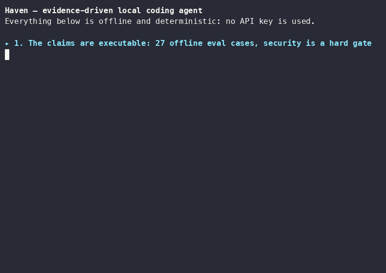
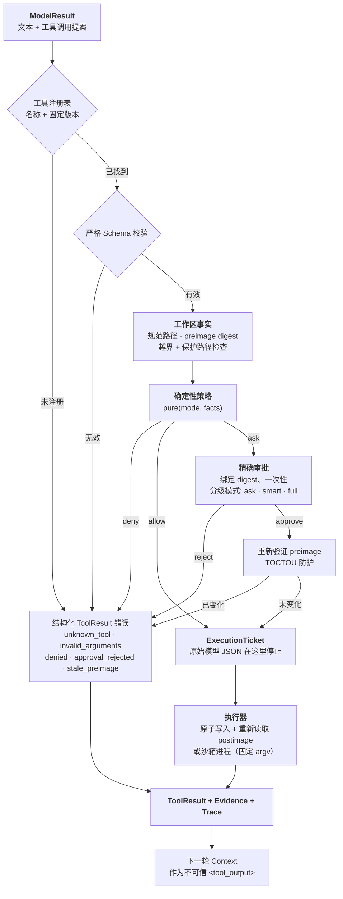

# Haven

[English](README.md) | **中文**

**一个以证据为驱动、可重放、运行范围受限的本地 TUI 编码代理。** 模型只负责提出动作；程序负责执行策略、审批、执行和成功判定。Haven 从零实现了生产级编码代理（类似 Claude Code / Codex CLI）背后的关键机制：有界代理循环、单一且可审计的工具执行通道、精确的人类审批、可持久化恢复，以及可复现的离线评估套件，而且不依赖代理框架。

> 核心价值：非确定性的模型永远只能“提案”；确定性代码掌握权限、执行和成功定义。



*完整离线演示（`./scripts/demo.sh`）包含确定性评估、安全门禁、配置来源、上下文检查和 `doctor`，不需要 API key。交互式 TUI 演示脚本见 `docs/DEMO.md`。*

## 它能做什么

在本地 Git 仓库中给 Haven 一个范围明确的编码任务。代理会搜索并阅读代码，提出精确修改，等待你的审批，以原子方式应用修改，运行已注册的验证配方，并在终端中展示流式回答、工具追踪、diff、测试证据、预算和唯一的停止原因。每次运行都会保存检查点，可恢复、可重放、可评估。

```text
打开本地 Git 仓库
  → 输入编码任务
  → 代理搜索、阅读并规划
  → 代理提出精确修改
  → TUI 展示 diff、风险和一次性审批范围
  → 你批准或拒绝
  → 执行器应用修改并运行固定验证配方
  → 代理可以在有界预算内修复失败
  → TUI 展示最终 diff、测试、成本、追踪和停止原因
```

## 快速开始（离线，不需要 API key）

仅安装运行依赖、检查平台支持或升级旧会话时，参见[安装与升级说明](docs/INSTALL_UPGRADE.zh-CN.md)。

```bash
uv sync --locked

# 运行确定性评估套件（ScriptedModel；无网络、无需密钥）
uv run haven eval --offline          # 全部用例通过，0 个安全违规
uv run python evals/generate_cases.py  # 修改用例后重新生成 JSON

# 查看已保存的运行 / 重放时间线
uv run haven sessions list
uv run haven replay <RUN_ID>

# 查看每个配置值的来源
uv run haven config explain

# 查看模型会看到什么上下文，以及原因
uv run haven debug-context "fix the failing parser test"
```

默认 Provider 兼容 OpenAI。进行真实运行时，设置密钥并启动 TUI：

```bash
export HAVEN_API_KEY=sk-...
export HAVEN_MODEL=gpt-4o-mini        # 可选；覆盖默认模型
uv run haven verify-provider --yes    # 发送一次很小的真实请求检查连通性
uv run haven                          # 在当前仓库启动交互式 TUI
```

任何支持流式传输和工具调用的 OpenAI-compatible Chat Completions endpoint 都可以配置。将 `HAVEN_API_KEY_ENV` 指向该 Provider 使用的环境变量即可：

```bash
export DEEPSEEK_API_KEY=sk-...
export HAVEN_API_KEY_ENV=DEEPSEEK_API_KEY
export HAVEN_BASE_URL=https://api.deepseek.com/v1
export HAVEN_MODEL=deepseek-v4-flash
```

## 单一执行通道

模型提出的每个动作都会经过同一条流水线；不存在从模型提案直达副作用的其他路径。左侧的每个出口都会产生结构化 `ToolResult`，再反馈给模型，而不是把原始异常直接交回去。



分层和状态机见 [`docs/ARCHITECTURE.md`](docs/ARCHITECTURE.md)，信任模型和每个阶段的保证见 [`docs/SECURITY.md`](docs/SECURITY.md)。

## 这个项目展示了什么

- 自定义 Provider 适配器、工具调用层和**有界代理循环**，每次运行都有一个明确的停止原因，而不是依赖预制框架。
- 清晰区分 **State ≠ Context ≠ Trace ≠ ModelResult**，并通过导入契约强制分层（`domain → application → ports`，适配器只能在唯一组合根后面）。
- 在真实仓库中实现 `search → read → edit → verify → diff` 循环。
- **确定性策略 + 绑定 digest 的一次性审批**（支持分级模式：`ask`、`smart`、`full`）、文件工具的严格路径限制，以及模型提议的通用 exec 必须经过原生沙箱，并带有 TOCTOU 和过期审批保护。
- **Evidence Gate**：修改文件的运行不能只凭模型一句话成功；必须在最后一次写入之后记录 diff 和通过的检查，并确定性审查写入内容（不能有提交的密钥、冲突标记、调试语句或被静默清空的文件）。只读运行没有可核对的产物，因此由预算和停止原因约束，而不是验证成功；这个边界记录在 ADR 0003 中。
- **持久化执行**：SQLite 检查点 + 追加式事件日志；恢复流程会分类中断的副作用，无法判断时绝不自动重放。
- 流式响应、取消、预算（步骤 / 工具 / 时间 / token / 成本）和卡死循环检测。
- 可复现的离线评估套件，覆盖任务、健壮性、安全、注入、预算和恢复用例，并有硬安全门禁。
- 具备独立上下文和父任务预算记账的只读 scout/reviewer 模型循环、带依赖和证据的结构化计划、受控 MCP 工具和工作树审阅。早期取舍见 ADR 0007、ADR 0023；当前行为见[能力说明](docs/REMAINING_CAPABILITIES.md)。

## 非目标（v1）

不受限制的多代理编排 · RAG/GraphRAG · 浏览器 / computer-use / 语音 / 图片 · 云账号或远程执行 · 不受限制的 shell（`repo.exec` 只接受 argv；显式 shell 解释器必须审批且仍处于沙箱中）· 自动 commit/push/PR · 多 Provider 路由。

## 命令面

<!-- BEGIN CLI COMMAND SURFACE -->

```text
haven                                # 在当前目录启动交互式 TUI
haven tui [PATH]                     # 在指定工作区启动交互式 TUI
haven init --workspace PATH [--accept]   # 一步初始化：环境摘要 + 配方发现
haven run GOAL --workspace PATH      # 无头模式；默认只读
haven run GOAL --write --approval-policy reject|trusted-recipe|all [--jsonl] [--events F]
haven run GOAL --plan                # 只读调研并生成待确认计划
haven run GOAL --write --worktree --review   # 保留验证后的改动，等待人工审阅
haven review RUN_ID [--file PATH --hunk N]   # 逐文件、逐 hunk 查看隔离改动
haven review RUN_ID --apply|--discard --binding DIGEST   # 确认或丢弃审阅快照
haven implement RUN_ID --approval-policy reject|trusted-recipe|all   # 确认并执行计划
haven answer RUN_ID --request ID --answers '{"scope":"Parser"}'  # 回答已保存的问题
haven continue RUN_ID FOLLOW_UP      # 保留上下文继续运行
haven discover --workspace PATH [--accept]   # 建议（或保存）.haven.toml 配方
haven doctor --workspace PATH        # 环境检查，不产生副作用
haven gc [--keep N] [--older-than-days D] [--yes]   # 清理旧运行（默认只预览）
haven sessions list | show RUN_ID
haven sessions list --search QUERY   # 按 ID、目标或状态搜索完整历史
haven replay RUN_ID                  # 纯日志投影，不调用模型或工具
haven resume RUN_ID                  # 恢复检查后进入 TUI
haven rewind RUN_ID                  # 撤销已完成运行的文件修改（失败即关闭）
haven reconcile RUN_ID CALL_ID --as confirmed|not_run|abandon
haven export RUN_ID --format jsonl|markdown
haven output RUN_ID [CALL_ID]        # 检查状态、诊断位置和已保存的进程日志
haven handoff RUN_ID [--prepare|--set FILE --expected-seq N|--history|--clear]
haven debug-context GOAL             # 模型会看到什么，以及原因
haven debug-context --run RUN_ID     # 查看每一步记录的上下文
haven eval --offline [--category task,security]
haven eval --live --yes              # 明确、有费用、不可复现
haven verify-provider --yes          # 明确操作，可能产生 Provider 费用
haven config explain --workspace PATH
```

<!-- END CLI COMMAND SURFACE -->

TUI 中的 `/help`、`/mode`、`/budget`、`/context`、`/new`、`/sessions`、`/skill`、`/fork`、`/rewind`、`/diff`、`/review`、`/export` 和 `/quit` 提供交互控制。`@path` 文件提及会让代理通过 `repo.read` 访问文件，不会绕过工具边界；运行期间输入的文字会排队到下一轮，而不是打断当前轮。

`/new` 开始全新对话；`/sessions QUERY` 可搜索历史，选择打开、恢复中断任务或分支。`/diff FILE` 可逐文件、逐 hunk 查看；TUI 隔离工作树合流前必须确认，保留后可用 `/review` 再次审阅。待回答或待审阅时不能启动另一项任务。

后台进程可通过 `task.input` 接收 stdin；`task.start(terminal=true)` 启用 POSIX PTY。计划步骤支持稳定 ID、依赖、阻塞原因、验收标准和真实证据引用。使用方法与边界见[能力说明](docs/REMAINING_CAPABILITIES.md)。

使用 `/plan GOAL` 进入只读规划，查看计划后可继续发消息修订；`/implement`（或 `/implement RUN_ID`）才会确认执行。普通追问和 `/mode` 审批策略切换不会解除规划限制。状态与恢复语义见 [Plan 模式](docs/PLAN_MODE.md)。

Agent 可以通过 `user.ask` 提出选择题或自由文本问题。TUI 展示回答表单，`/answer` 可重新打开；无头运行以退出码 `8` 返回 `needs_input`，用 `haven answer` 回答后继续同一次运行。等待期间不轮询模型，问题、预算和证据可恢复；暂停工作树也会保留。详见 [用户追问](docs/USER_INPUT.md)。

退出码稳定：`0` 成功 · `2` 用法错误 · `3` 策略 / 权限 · `4` Provider · `5` 工具 · `6` 预算 / 停止 · `7` 需要恢复 · `8` 等待回答。

TUI 主输入框支持 ↑/↓ 浏览最近 20 条已提交任务；向下越过最新一条时，会恢复浏览前
尚未提交的草稿。历史按工作区保存到现有会话数据库，重启后仍可使用；草稿只保留在
内存中。斜杠命令和追问表单的答案不会加入任务输入历史。
使用 `/history` 查看，`/history clear` 只清除当前工作区的输入历史。
在浏览历史时执行这两个命令，会恢复浏览前的草稿。
使用 `/memory` 查看新运行将采用的已加载项目指引，以及来源、范围、未加载原因和
截断情况。查看只展示已有快照，不重新读取文件或调用模型。
空闲时用 `/memory reload` 重新加载外部修改，下一次新任务或后续轮次采用新内容；
运行中、等待回答或等待审阅时不能刷新。恢复旧任务沿用该任务保存的快照；
没有快照的旧检查点会提示后使用当前指引。刷新读取实际工作区（启用隔离时为工作树），
权限、技能、验证配方和 MCP 配置不随之刷新。
空闲时在 `/remember` 后输入约定正文，可保存到 Haven 本地用户数据。
`/memory` 展示笔记 ID 和创建时间；`/memory forget ID` 删除一条，
`/memory clear` 清空本项目笔记。最多 20 条、每条 500 字符、正文合计 2000 字符；
达到容量时拒绝新增。笔记与仓库指引分开，作为不可信资料进入新运行；
重启及更换隔离工作树后，仍按同一主工作区加载。删除笔记不改写历史任务中的快照。
修改笔记不重新读取仓库文件；外部文件修改仍用 `/memory reload` 加载。

用 `/verify` 查看验证配置组和当前结果；`/verify use NAME` 选择下一次运行
必须通过的检查，`/verify clear` 显式清除下一次的选择。
无头运行可用 `--check-group NAME`，后续轮次默认继承原要求。
每项必需检查都要按配置的完整命令在最后一次写入后通过；
漏项、失败、过期或追加筛选参数的结果均不能满足要求。
配置、权限、Plan、恢复与 `--clear-check-group` 见
[验证配置组](docs/VERIFICATION_GROUPS.md)。

使用 pytest 和 Ruff 的项目可按 [Python 工程流程](docs/PYTHON_WORKFLOW.zh-CN.md)
完成配方预览与确认、环境及权限检查、隔离修改、两项验证和审阅应用。
`doctor` 会报告 Haven 同一 Python 环境中缺失的 pytest/Ruff 模块；
其他解释器的依赖可用性明确标为未知。

Evidence 页集中展示必需检查状态、最近的进程结果、诊断位置和日志回看命令。
`/output` 切换到该页，`/output CALL_ID` 只读分页查看日志，不调用模型。
无头运行用 `haven output RUN_ID` 查看概览，加 `CALL_ID` 回看日志。
保存上限、分页和导出方式见[进程输出说明](docs/PROCESS_OUTPUT.zh-CN.md)。

`/handoff` 查看任务事实和工作笔记；用 `/handoff prepare`、`/handoff edit`、
`/handoff history`、`/handoff clear` 显式整理暂停或结束任务的交接。
决策、尝试和下一步可跨压缩与恢复保留，笔记仍是不可信资料，
必需检查始终从账本计算。追问表单的 **Keep paused** 可保留问题并回到主界面，
稍后用 `/answer` 重开。使用和恢复边界见[长任务交接](docs/HANDOFF.zh-CN.md)。

`/model` 查看模型预设和最近一次调用，`/model use NAME` 为后续新运行选择预设。
无头运行接受 `--model-preset NAME`。保存的任务沿用原路由恢复。见[模型预设](docs/MODEL_PRESETS.zh-CN.md)。

`/stats` 或 `haven sessions stats RUN_ID` 汇总单次运行的模型和工具耗时、重读范围、
上下文构建、token 和估算费用。最慢的调用带有事件序号，可在 JSONL 导出中查阅。
工具耗时包含审批等待。压缩次数按日志中带摘要或预算截断的构建计算。
进行中的运行显示已记录的数据。

任务完成、失败或等待回答时，TUI 和交互终端中的人类可读无头运行会触发终端响铃。
设置 `HAVEN_BELL=0` 可关闭；终端设置决定它是声音还是视觉提示。重定向输出、
JSON 输出、重放和委派子任务结束时不会响铃。常见密钥、验证配方和权限错误会附带
下一步操作建议；请在任务的工作区中运行建议的配置命令。

## 开发

```bash
uv sync --locked
uv run python scripts/gates.py --mode fast   # 格式、lint、类型、分层、文档、说明
uv run python scripts/gates.py               # CI 强制的全部检查
uv run python scripts/gates.py --list        # 检查图及其依赖
```

检查项及其依赖只在 `scripts/gates.py` 中声明一次，CI 运行同一张图（`--mode full`），因此本地命令和 CI 步骤不会漂移。测试完全离线且确定性：默认模型是 `ScriptedModel`，没有测试访问网络或真实 API key。

## 测量结果

离线测试、覆盖率和评估可以不使用 API key 复现；实时模型成绩是历史测量，
不表示本版本重新跑过。表格由 `scripts/refresh_metrics.py` 生成，CI 检查漂移。
工作区之外的测量可用 `--coverage-data PATH`、`--offline-report PATH` 指定；
加 `--preserve-historical-live` 保留已有历史成绩，不读取真实评测目录。
用相同参数加 `--check` 可验证生成表。

<!-- BEGIN GENERATED METRICS (scripts/refresh_metrics.py; do not edit by hand) -->

| 指标 | 数值 |
|---|---|
| 自动化测试 | 1464 |
| 行覆盖率（`src/`） | 91% |
| 源码 / 测试规模 | 约 30.5k / 约 25.3k 行 |
| 类型检查模块（`mypy --strict`） | 152 |
| 架构决策记录 | 50 |
| 离线评估 | 45/45 通过，0 个安全违规 |
| 评估类别 | security 20 · task 10 · robustness 6 · injection 4 · budget 3 · recovery 2 |
| 历史实时真实仓库套件（deepseek-v4-flash） | 修复后 75/79（31/31 + 9/9 + 5/5 + 20/20 + 9/13 + 1/1）；0 个安全违规——原始运行和根因见 docs/EVAL_LIVE.md |
| 历史同版本完整重跑 | 一次不间断运行中 61/65（失败归因见 docs/EVAL_LIVE.md） |

<!-- END GENERATED METRICS -->

其他固定保证：`ruff`、`mypy --strict` 和 `import-linter`（3 个分层契约）会阻止不合格提交；golden trace 在运行之间稳定，TUI 和无头模式产生相同 trace；实时 DeepSeek 运行记录在 [`docs/EVAL_LIVE.md`](docs/EVAL_LIVE.md)。

[`docs/PROJECT_CARD.md`](docs/PROJECT_CARD.md) 是一页式摘要和权衡表；[`docs/POSTMORTEM.md`](docs/POSTMORTEM.md) 记录开发期间发现的三个真实缺陷，其中一个是安全门禁本身的错误。

## 文档

| 文档 | 内容 |
|---|---|
| [`docs/ARCHITECTURE.md`](docs/ARCHITECTURE.md) | 分层、执行通道和状态机图 |
| [`docs/SECURITY.md`](docs/SECURITY.md) | 资产、主体、攻击面、防御和限制 |
| [`docs/EVAL.md`](docs/EVAL.md) | 用例设计、指标、离线与实时评估 |
| [`docs/EVAL_LIVE.md`](docs/EVAL_LIVE.md) | 每次真实模型测量及其暴露的缺陷 |
| [`course/`](course/README.md) | 三门零基础预备课、一个推导模块和十个分层模块，教你从这个仓库学习代理工程；含分层、执行通道和状态机图示 |
| [`docs/DEMO.md`](docs/DEMO.md) | 2–3 分钟演示脚本 |
| [`docs/PROJECT_CARD.md`](docs/PROJECT_CARD.md) | 一页式摘要、测量结果和权衡 |
| [`docs/RESUME.zh-CN.md`](docs/RESUME.zh-CN.md) | 可直接拼接进简历的中文项目条目和面试讲述提纲 |
| [`docs/DESIGN_QA.md`](docs/DESIGN_QA.md) | 每个关键设计决策的质询记录 |
| [`docs/POSTMORTEM.md`](docs/POSTMORTEM.md) | 真实失败、根因和回归防护 |
| [`docs/DEFENSIVE_PATTERNS.md`](docs/DEFENSIVE_PATTERNS.md) | 编写策略、边界、门禁或 Provider 代码前应阅读的防御规则 |
| [`docs/LEARNING.md`](docs/LEARNING.md) | 阅读顺序、事实层级，以及当前文档与历史计划的边界 |
| [`docs/ADR_INDEX.md`](docs/ADR_INDEX.md) | 生效中的决策导航、历史裁决和新增 ADR 准入规则 |
| [`docs/notes/`](docs/notes/) | 轻量级决策笔记 |
| [`docs/adr/`](docs/adr/) | 不就地改写的架构决策历史记录 |
| [`docs/ROADMAP3.md`](docs/ROADMAP3.md) | 已执行的改进计划——唯一保留的路线图。前两轮已于 2026-11-17 并入：其阶段计划已执行完毕，值得保留的两节（经代码核对的外部声明、三轮审计的共识）复制在篇首 |
| [`docs/PERSONAL_ROADMAP.md`](docs/PERSONAL_ROADMAP.md) | 个人长期规划：优先级、阶段、验收标准与范围（尚未实施的路线图） |
| [`docs/codebase/`](docs/codebase/README.md) | 七视角审计伴侣——结构、技术栈、约定、测试、集成、架构和分级风险登记册。改动策略、边界、门禁或 Provider 代码前先读 `CONCERNS.md` |

## 从这个仓库学习

`course/` 是一套自学课程，带你通过阅读和扩展这个仓库来构建生产级编码代理。三门预备课先从零讲清 LLM、Tool Calling 与 Agent，补齐阅读 Haven 所需的 Python 构件，再带你跑通一条完整离线 Trace；之后从故障推导系统，并依次深入 Provider 契约、工具执行通道、Evidence Gate、持久化恢复和评估。所有模块都指向真实文件、ADR、测试和实时模型失败案例。课程完全离线运行，最后以结业项目收尾。从 [`course/README.md`](course/README.md) 开始。

## 设计参考

Haven 是独立实现的 Python 项目。[Morrow](https://github.com/dyxnb22/Morrow) 是单一工具执行通道、策略绑定审批和可重放评估等原则的设计参考；Haven 没有 fork 或复制 Morrow 源码。设计决定与权衡见 `docs/adr/`，历史原始计划见 `Haven_TUI_Coding_Agent_项目计划.md`。

## 已知限制

- 模型提议的 `repo.exec` 需要 Seatbelt（macOS）或 Landlock（Linux），在工作区只读、不能读取 `$HOME`、不能访问网络（Landlock 覆盖 TCP；UDP/DNS 仍是 Linux 的已知缺口）。注册的 `repo.check` 使用可写工作区配置，并可通过已审阅配方选择网络；审批卡会再次展示实际命令、工作区写权限、网络权限和额外可读目录。没有沙箱后端的平台仍会在本地信任仓库假设下运行检查，但会拒绝 `repo.exec`。这不是容器或虚拟机：IPC 是开放的，`$HOME` 之外的密钥可能仍可读取。见 [ADR 0009](docs/adr/0009-os-sandbox-and-general-exec.md)、[ADR 0013](docs/adr/0013-sandbox-scope-exec-vs-check.md) 和 [ADR 0030](docs/adr/0030-exact-effect-attribution.md)。
- Token 用量来自 Provider 或有标记的估算。费用按费率卡估算，费率缺失时显示 `unknown`。
- 单仓库、单 Provider、固定验证配方，不自动修改 Git 历史。

## 许可证

[MIT](LICENSE) © 2026 diaoyuxuan。
