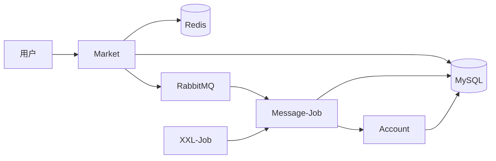
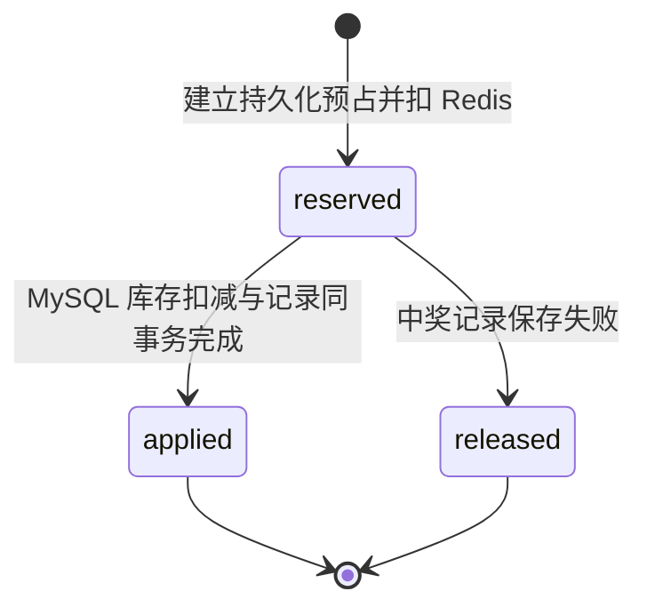

# Big-Market 代码阅读路线

目标：从“一次用户抽奖”出发，读懂参与订单、概率选奖、规则判断、库存预占、中奖记录、消息任务和积分入账，而不是按 Maven 模块逐个翻文件。

项目根目录：`/Users/diaoyuxuan/big-market-ai-platform`

## 1. 先建立全局图

面试主线只需要先掌握三个服务：

| 服务 | 主职责 | 本轮暂不深挖 |
| --- | --- | --- |
| Market | HTTP 抽奖入口、活动用例编排、同步落中奖事实 | Chatbot、管理端、搜索等旁支 |
| Message-Job | MQ 消费、Outbox 扫描、库存与远程写补偿 | 所有非抽奖主题的 Job |
| Account | 积分账户、积分订单、业务号幂等 | 与抽奖无关的账户能力 |

基础设施只保留四类：MySQL 保存业务事实，Redis 承担热点查找和库存预占，RabbitMQ 解耦同步抽奖与发奖，XXL-Job 扫描未完成任务。



第一遍不要读 Gateway、Auth、Admin、Chatbot，也不要从每个模块的配置类开始。等主链路完全走通，再用这些模块回答服务治理或扩展问题。

## 2. 代码搜索起手式

```bash
cd /Users/diaoyuxuan/big-market-ai-platform

rg -n "draw_by_token|executeDraw|performRaffle|saveUserAwardRecord" \
  big-market-trigger big-market-domain big-market-infrastructure

rg -n "reserveStock|confirmAwardStockReservation|releaseAwardStockReservation" \
  big-market-domain big-market-infrastructure big-market-message-job-service

rg -n "credit_award_task|awardOrderId|outBusinessNo" \
  big-market-domain big-market-infrastructure big-market-message-job-service \
  big-market-account-service
```

搜索结果的阅读顺序是“调用者 → 接口 → 当前实现 → DAO/缓存”，不要看到同名方法后随机打开。

## 3. 主链路总览

```text
RaffleActivityController
  → RaffleDrawApplicationService
  → RaffleApplicationService.executeDraw
      1. createOrder：复用未使用订单，或扣总/月/日额度并建参与单
      2. performRaffle：责任链选范围，算法选候选奖，规则树校验次数与库存
      3. saveUserAwardRecord：中奖记录 + send_award task + 参与单 create→used
      4. confirm stock：确认库存预占；失败则保存补偿任务

异步阶段
  SendMessageTaskJob / MQ
  → SendAwardConsumer
  → AwardService.distributeAward
  → UserCreditRandomAward
  → 中奖记录 CAS + credit_award_task
  → DispatchCreditAwardTaskJob
  → AccountCreditServiceRPC
  → user_credit_order / balance
```

这条链路需要拆成“同步抽奖”和“异步履约”两段讲。同步接口返回中奖结果时，积分可能尚未最终入账。

---

# 第一阶段：参与订单与抽奖编排

## 4. 先读 `RaffleApplicationService.executeDraw`

这是全项目最重要的导航文件。第一遍只标记以下局部变量和布尔值：

| 变量 | 业务含义 | 为什么重要 |
| --- | --- | --- |
| `orderEntity` | 本次抽奖使用的参与订单 | 串起次数、策略、中奖和幂等 |
| `raffleAwardEntity` | 候选奖和库存预占信息 | 决定失败时是否需要释放库存 |
| `awardSaved` | 中奖记录是否已经落库 | 决定是否允许返还额度、释放库存 |

顺着代码回答：

1. 参数错误发生在任何业务写入之前吗？
2. 参与订单创建完成后，哪些失败需要补偿额度？
3. 中奖记录保存后，库存确认失败为什么不让整个中奖事实回滚？
4. `awardSaved=true` 后发生异常，为什么不能再次返还次数？

### 本节输出

画一张包含三个分支的图：正常成功、中奖记录保存失败、中奖记录成功但库存确认失败。

## 5. 再读参与订单

按下面顺序：

1. `domain/activity/service/partake/AbstractRaffleActivityPartake.java`
2. `domain/activity/service/partake/RaffleActivityPartakeService.java`
3. `domain/activity/model/aggregate/CreatePartakeOrderAggregate.java`
4. `infrastructure/adapter/repository/ActivityPartakeOrderSupport.java`
5. 对应 Mapper XML 中的条件扣减 SQL。

### 正常路径

```text
校验活动状态和时间
  → 查询 create 状态的未使用参与单
  → 有：直接返回，不再次扣额度
  → 无：检查总/月/日额度
      → 构造参与单
      → 同一本地事务内条件扣额度并插入参与单
```

### 阅读重点

- `queryNoUsedRaffleOrder` 是“复用未完成业务意图”，不是简单 Redis 防重复。
- 总/月/日额度和参与订单在本地路径中由同一事务保存。
- DAO 更新行数必须为 1；行数为 0 表示余额/额度条件不再满足。
- 唯一键冲突会回滚整个事务，不能只吞掉异常继续抽奖。

### Java 基础映射

- 模板方法：父类固定参与流程，子类实现额度过滤和订单构建。
- 聚合：多张表在一个业务不变量下共同提交。
- Spring 事务：理解 `TransactionTemplate` 的提交、回滚和异常传播。
- MySQL 条件更新：`UPDATE ... WHERE surplus > 0` 为什么比“先查再减”安全。

### 自测题

- 用户第一次请求在扣次数后进程退出，第二次请求为什么不会再扣一次？
- “先查询额度，再普通 UPDATE”有什么竞态？
- 参与订单为什么要有 `create` 和 `used` 状态？

---

# 第二阶段：概率装配与选奖

## 6. 按“装配”和“抽取”分开读

装配路径：

```text
AbstractStrategyAlgorithm.assembleLotteryStrategy
  → 查询奖品及概率
  → 缓存每个奖品库存
  → 装配默认概率结构
  → 按 rule_weight 奖品子集装配额外结构
  → StrategyArmoryDispatch 选择 O1 / OLogN
```

抽取路径：

```text
DefaultLogicChain 或 RuleWeightLogicChain
  → IStrategyDispatch.getRandomAwardId
  → StrategyArmoryDispatch.dispatchAlgorithm
  → 从 Redis 取已缓存的算法名
  → O1Algorithm / OLogNAlgorithm
```

## 7. 手算一次 O(1) 查找表

假设三种奖品概率为 0.5、0.3、0.2，离散范围为 10：

```text
奖品 A 占 5 格
奖品 B 占 3 格
奖品 C 占 2 格
打乱后写入 0..9 → awardId 的映射
抽奖时 nextInt(10) → Hash GET
```

阅读 `O1Algorithm` 时确认：

- 为什么 `nextInt(rateRange)` 的上界不包含 `rateRange`；
- 实际存储大小来自生成后的 Map，而不是盲信计算值；
- 空表和未命中为什么抛异常，而不是返回任意备用奖。

## 8. 手算一次累计区间

同样的概率可保存为：

```text
A: [1, 5]
B: [6, 8]
C: [9, 10]
随机数范围：[1, 10]
```

阅读 `OLogNAlgorithm` 时区分三个概念：

- 概率精度决定随机范围；
- 奖品数量决定遍历、二分或并行查找分支；
- 类名叫 OLogN，不代表每个实际分支都严格是 O(log n)。少量奖品直接遍历，大量奖品还存在并行分段实现。

## 9. 阈值的正确表达

`StrategyArmoryDispatch` 中的 10000 是离散概率范围的切换阈值：

- 小范围允许展开查找表，以空间换热点查询时间；
- 大范围保存累计区间，防止因小数精度高而生成过大的 Hash；
- 它不是 QPS 阈值，也不是库存阈值；
- 当前仓库没有证明 10000 对所有部署都是最优值。

### 本节输出

- 手绘两种数据结构；
- 用 60 秒回答“为什么有两种算法”；
- 写出一个概率配置校验清单：非负、总和、最小精度、空奖品集、权重子集。

---

# 第三阶段：责任链与决策树

## 10. 先看两阶段总入口

阅读 `AbstractRaffleStrategy.performRaffle`，只记住：

```text
责任链：决定候选奖从哪个范围产生
规则树：判断候选奖是否满足发放条件
```

然后进入 `DefaultRaffleStrategy`，确认即使责任链的黑名单或权重节点接管了候选奖，仍然调用 `raffleLogicTree`。

## 11. 责任链阅读顺序

1. `DefaultChainFactory.openLogicChain`
2. `AbstractLogicChain.appendNext/next`
3. `BlackListLogicChain`
4. `RuleWeightLogicChain`
5. `DefaultLogicChain`

逐个节点记录：输入、命中条件、返回候选奖的方式、是否继续到下一节点。

重点解释 Prototype：每条链的节点都保存 `next` 引用；若这些 Bean 是单例，策略 A 建链会覆盖策略 B 的节点连接。Prototype 让每次组装拿到独立节点对象。

## 12. 决策树阅读顺序

1. `DefaultRaffleStrategy.raffleLogicTree`
2. `DefaultTreeFactory.openLogicTree`
3. `DecisionTreeEngine.process`
4. `RuleLockLogicTreeNode`
5. `RuleStockLogicTreeNode`
6. `RuleLuckAwardLogicTreeNode`

不要背 `ALLOW` / `TAKE_OVER` 的中文直觉，要看每个节点返回值与数据库边的实际配置。核心业务结果是：次数不够或库存不足时沿配置边转到备用奖；库存预占成功时保留原候选奖并把预占凭据向上返回。

### 可执行规格

优先读：

```text
big-market-domain/src/test/java/com/dyx/market/domain/strategy/service/
AbstractRaffleStrategyTakeoverStockTest.java
```

先从测试名和断言猜设计，再回生产代码确认。测试要回答：责任链接管后，有限库存奖品是否仍执行库存节点。

### 本节输出

- 一张“责任链 vs 决策树”比较表；
- 为“新增会员等级规则”分别设计前置链节点和后置树节点，并说明应该放哪一层；
- 回答规则配置修改后的缓存失效问题。

---

# 第四阶段：库存一致性

## 13. 用状态机读，不要只盯 Lua

建议把 `reservationId` 视为整条库存链路的主键，当前抽奖路径使用参与订单号。



## 14. 预占路径

阅读顺序：

1. `RuleStockLogicTreeNode`
2. `StrategyRepository.reserveAwardStock`
3. `StrategyAwardCacheSupport.reserveStock`
4. `strategy_award_stock_decrement_ledger` 对应 DAO、Mapper 和 SQL。

在 `reserveStock` 中标记四个关键动作：

1. 用 `reservationId` 查询或插入持久化预占记录；
2. Lua 先检查 Redis 中是否已有同一预占结果；
3. 原子执行库存 DECR、负数回正、剩余量锁位和预占结果缓存；
4. 将 `lockSurplus` 回写持久化记录。

这里需要主动思考崩溃窗口：

| 中断位置 | 已知事实 | 恢复依据 |
| --- | --- | --- |
| 持久化记录前 | 没有预占事实 | 可重新开始 |
| 记录后、Lua 前 | `reserved` 但无 `lockSurplus` | 恢复逻辑可按同一 ID 重试预占 |
| Lua 后、回写 `lockSurplus` 前 | Redis 已保存同一 ID 的结果 | 重试脚本返回原剩余量，不再次 DECR |
| 回写后、中奖落库前 | 有完整预占 | 失败路径按 ID 释放 |

## 15. 确认与释放

回到 `RaffleApplicationService`：

- `saveUserAwardRecord` 失败：中奖事实不存在，释放预占并补偿参与额度；
- `saveUserAwardRecord` 成功：中奖事实已经存在，只能确认库存；
- 确认入队失败：保存待确认任务，由 `StrategyAwardStockConfirmJob` 继续，禁止释放。

释放逻辑本身也要幂等。重复释放若每次都 `INCR`，会凭空增加库存；因此代码按 `reservationId` 检查持久化状态并使用释放去重键。

## 16. 异步落库

阅读：

1. `UpdateAwardStockJob`
2. `StrategyAwardCacheSupport.syncStrategyAwardStockFromQueue`
3. `updateStrategyAwardStockOnce`

要点：

- 延迟队列把热点 Redis 扣减与 MySQL 写分开；
- MySQL 更新成功后才 ACK 队列项；失败保留，等待重试；
- 持久化记录与 MySQL 库存扣减同事务；
- Redis SETNX 是快速路径，但是否完成最终以 MySQL 记录判断；
- Redis 待处理集合丢失时，还可以扫描持久化 `reserved` 记录恢复。

### 可执行规格

优先读：

```text
big-market-infrastructure/src/test/java/com/dyx/market/infrastructure/adapter/repository/
StrategyAwardCacheSupportTest.java

big-market-domain/src/test/java/com/dyx/market/domain/activity/application/
RaffleApplicationServiceStockRollbackTest.java

big-market-message-job-service/src/test/java/com/dyx/market/message/job/config/
StrategyAwardStockConfirmJobTest.java
```

### 本节输出

- 画出预占、确认、释放三条路径；
- 闭卷解释四个崩溃窗口；
- 回答“为什么数据库记录比 Redis 去重键更可信”。

---

# 第五阶段：中奖记录、Outbox 与积分到账

## 17. 第一层 Outbox：中奖事实到发奖消息

阅读顺序：

1. `AwardService.saveUserAwardRecord`
2. `UserAwardRecordAggregate`
3. `AwardDispatchSupport.saveUserAwardRecord`
4. `IAwardDispatchTaskOutboxPort` 的当前实现
5. `SendMessageTaskJob`
6. `SendAwardConsumer`

事务内发生：

```text
insert user_award_record
  + insert task
  + CAS user_raffle_order: create → used
```

事务外尽力发布 MQ，成功则更新任务状态，失败则保留失败状态供 Job 扫描。理解它的核心不是“用了 RabbitMQ”，而是消息发布失败后仍有一条持久化任务证明需要继续发奖。

### 必问失败窗口

| 方案 | 失败窗口 | 结果 |
| --- | --- | --- |
| 先发 MQ、再写中奖记录 | MQ 成功、数据库失败 | 消费者可能发放不存在的中奖 |
| 先写中奖记录、无 Outbox 再发 MQ | 数据库成功、进程在发 MQ 前退出 | 中奖永远没人履约 |
| 中奖记录与 Outbox 同事务 | 发布失败 | Job 能从任务表恢复 |

## 18. 第二层 Outbox：积分奖品到 Account

阅读顺序：

1. `AwardService.distributeAward`
2. `UserCreditRandomAward.giveOutPrizes`
3. `AwardCreditGrantSupport.saveGiveOutPrizesAggregate`
4. `LocalAwardCreditWritePort.insertCreditAwardTask`
5. `DispatchCreditAwardTaskJob`
6. `AccountRemoteCreditWriteAdapter`
7. `PendingRemoteWriteSupport` 与 `RemoteWriteReconcileJob`
8. `AccountCreditApplicationService` 与 `CreditAdjustService`

本地事务是：中奖记录按预期状态 CAS 成功后，插入 `credit_award_task`。CAS 更新 0 行说明已经处理，不应重复插任务。

后台派发的顺序是：

```text
调用 Account(outBusinessNo = awardOrderId)
  → 成功：本地任务标记 dispatched
  → 明确拒绝：记录失败，不假装成功
  → 超时/未知：先探测账户流水；仍无法确定则写待对账任务
```

如果 Account 已入账、但本地 `dispatched` 尚未更新就崩溃，下一次会重复调用。正确性依赖 Account 对同一 `outBusinessNo` 的唯一约束或幂等处理，而不是依赖 Job 永不重复。

## 19. 三个状态不要混淆

| 状态 | 证明了什么 | 没有证明什么 |
| --- | --- | --- |
| 参与订单 `used` | 这张参与单已形成中奖记录 | 奖品已经最终发到用户 |
| 中奖记录完成 | 本地奖品履约流程已接管并写入积分任务 | Account 已经增加余额 |
| 积分任务 `dispatched` + Account 流水 | 远程入账调用已被确认或幂等接受 | 不代表所有外围读模型立即同步 |

面试回答“积分是否到账”时，要沿同一 `awardOrderId` 关联中奖记录、积分任务和账户流水，不能只看一张表。

### 本节输出

- 画两层 Outbox；
- 写出 `messageId`、`orderId/awardOrderId`、`outBusinessNo` 各自的作用；
- 用 90 秒解释 RPC UNKNOWN 和明确失败的区别；
- 说明为什么 RabbitMQ 的至少一次投递需要消费者幂等。

---

# 第六阶段：从数据库反向读代码

## 20. 关键表与反向追踪

| 表或记录 | 从哪里写入 | 谁继续处理 | 主业务键 |
| --- | --- | --- | --- |
| `user_raffle_order` | 参与订单保存 | 中奖记录事务将其置为 used | `order_id` |
| `user_award_record` | 第一层 Outbox 事务 | 发奖消费者、用户查询 | `order_id` |
| `task` | 第一层 Outbox 事务 | 发送任务 Job | `message_id` |
| `strategy_award_stock_decrement_ledger` | 库存预占 | 库存回写与恢复 | `reservation_id` |
| `credit_award_task` | 积分奖品事务 | 积分派发 Job | `award_order_id` |
| `pending_remote_write_task` | RPC UNKNOWN | 远程写对账 Job | `out_business_no` |
| `user_credit_order` | Account 入账 | 对账和用户流水查询 | `out_business_no` |

反向阅读命令示例：

```bash
rg -n "insertCreditAwardTask|queryPendingTasks|updateDispatched" \
  big-market-* -g '*.java' -g '*.xml'

rg -n "strategy_award_stock_decrement_ledger|reservation_id" \
  big-market-* docs/sql -g '*.java' -g '*.xml' -g '*.sql'
```

反向读表适合回答“这条状态是谁写的、谁消费、重复时怎样处理”，比从 Controller 一路读到底更容易发现遗漏。

# 第七阶段：项目知识回扣 Java 后端基础

## 21. 基础知识映射

| 项目实现 | 必须回补的基础 | 面试连接方式 |
| --- | --- | --- |
| `TransactionTemplate` 聚合保存 | ACID、隔离级别、回滚、条件更新 | 事务解决单库原子性，不能覆盖 RPC |
| Redis 概率表 | Hash、随机数、空间/时间复杂度 | O(1) 是查询阶段，不包含装配 |
| Lua 库存预占 | Redis 原子执行、幂等键、过期 | 原子性只覆盖脚本内 Redis 操作 |
| Outbox | 本地事务、MQ 至少一次、补偿扫描 | 最终一致，不是 Exactly Once |
| Redisson 锁 | 锁粒度、watchdog、租约、唯一键 | 锁降低并发重复，数据库约束兜底 |
| Dubbo 调用 | 超时、重试、服务发现、序列化 | 超时不能推导远端失败 |
| 分库分表 | 路由键、跨分片查询、唯一性范围 | Job 扫描需要显式遍历 DB/TB |
| 状态机 | CAS、合法转换、终态 | 用状态约束重试，而不是靠日志猜测 |

## 22. 常见错误表述

| 不准确说法 | 更准确的说法 |
| --- | --- |
| “Redis 和 MySQL 保持强一致” | Redis 负责热点预占，MySQL 记录持久化事实，异步追平并补偿 |
| “MQ 保证只消费一次” | 消息可能重复，业务唯一键、CAS 和幂等账户写防止重复效果 |
| “O(log n) 算法始终二分” | 累计区间实现按奖品数选择遍历、二分或并行查找 |
| “中奖记录完成就是积分到账” | 本地履约完成后还需积分任务派发与 Account 流水确认 |
| “用了 DDD，所以服务完全解耦” | Domain 通过 Port/Repository 隔离实现；仍需说明实际同步和异步边界 |
| “这套设计保证零超卖” | 代码覆盖多个并发和崩溃窗口，但没有生产容量与故障注入结论 |

# 第八阶段：闭卷验收

## 23. 必须能画的三张图

1. 一次抽奖：Controller → 参与订单 → 策略 → 中奖记录 → 库存确认。
2. 库存三阶段：reserve → confirm/apply 或 release。
3. 两层 Outbox：中奖事实 → MQ 发奖 → 积分任务 → Account。

## 24. 必须能回答的十个问题

1. 未使用参与订单为什么要复用？
2. 为什么概率表要在活动开始前装配？
3. 10000 阈值控制的是什么？
4. 责任链和决策树分别解决什么问题？
5. 黑名单接管的奖品为什么还要过库存节点？
6. 中奖记录保存失败后，额度和库存分别怎样处理？
7. 中奖记录成功但库存确认失败，为什么不能释放？
8. 第一层和第二层 Outbox 各保证哪两个事实一起落库？
9. Account 超时为什么不能直接回滚或重新发积分？
10. 哪些代码事实能证明幂等，哪些生产指标当前无法证明？

只要其中任何一道需要依赖“因为用了 Redis/RabbitMQ”这种回答，就回到对应状态变化和失败窗口继续读。

