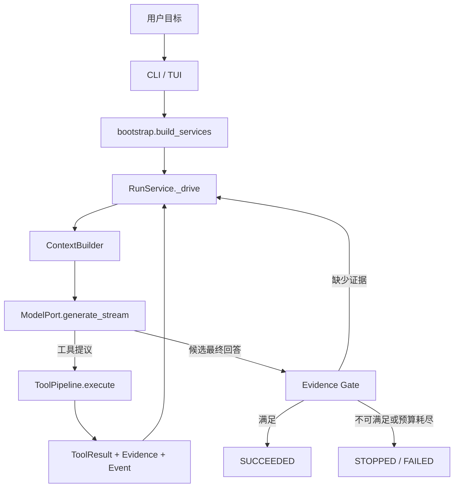

# Haven 代码阅读路线

目标：从一次本地编码任务出发，读懂模型怎样循环提出操作、程序怎样决定能否执行、怎样判断任务完成，以及中断后为什么不会盲目重放副作用。

项目根目录：`/Users/diaoyuxuan/Haven`

Haven 是 Java 后端简历中的差异化项目。阅读重点是确定性控制、状态机、持久化和失败恢复，不要先花大量时间研究 TUI 样式或所有 Provider 兼容细节。

## 1. 一句话业务模型

> 模型负责提出建议；确定性程序负责校验、授权、执行、记录、验证和停止。

围绕这句话，项目可以拆成四条链：

1. 运行链：用户目标如何驱动 Model → Tool → Observation 循环；
2. 执行链：不可信工具提议如何变成可执行操作；
3. 完成链：什么证据足以把一次修改判定为成功；
4. 恢复链：中断副作用如何分类，什么时候必须人工处理。

## 2. 分层地图

| 层 | 负责什么 | 不负责什么 |
| --- | --- | --- |
| `interfaces` | CLI/TUI 输入与事件展示 | 执行工具、决定权限 |
| `bootstrap.py` | 组装端口和适配器 | 业务规则 |
| `application` | 运行循环、工具编排、恢复用例 | 直接依赖具体 Adapter |
| `domain` | 权限、预算、审批摘要、证据门禁、状态转换 | 文件、网络、数据库 I/O |
| `ports` | 核心所需能力的 Protocol | 具体实现 |
| `adapters` | 文件、SQLite、模型、进程、沙箱实现 | 修改领域规则 |
| `contracts` | 跨边界的严格 Pydantic DTO | 行为编排 |

第一次阅读只看 `src/haven/__init__.py` 的包说明和 `src/haven/bootstrap.py::build_services`，确认依赖方向。不要逐个打开适配器。

## 3. 搜索起手式

```bash
cd /Users/diaoyuxuan/Haven

rg -n "class RunService|def _drive|class ToolPipeline|def execute" \
  src/haven/application

rg -n "evaluate_policy|compute_approval_digest|mint_ticket|evaluate_evidence_gate" \
  src/haven/domain src/haven/application

rg -n "EFFECT_UNKNOWN|def inspect|def reconcile|def rewind" \
  src/haven/application src/haven/interfaces src/haven/domain
```

本学习路线不需要读取 `evals/real/`、`evals/headtohead/` 或生成的 `eval_report/`。

## 4. 总体主链路



---

# 第一阶段：运行循环

## 5. 从入口跟到组合根

阅读顺序：

1. `src/haven/interfaces/cli.py`
2. `src/haven/interfaces/cli_support/run_commands.py`
3. `src/haven/bootstrap.py::build_services`
4. `src/haven/application/run_service.py::RunService.run`
5. `src/haven/application/run_service.py::RunService._drive`

### 入口需要回答

- 不带子命令为什么打开 TUI？
- 无头 `run` 为什么默认只读？
- `--write` 为什么仍然需要审批策略？
- 同一工作区出现第二个写进程时，工作区租约如何处理？

### 组合根需要回答

`build_services` 是唯一知道具体 Adapter 的位置。把下列接口与实现连线：

| Port | 当前典型 Adapter |
| --- | --- |
| `ModelPort` | `OpenAICompatibleModel` 或测试中的 `ScriptedModel` |
| `WorkspacePort` | `FsWorkspace` |
| `ExecutorPort` | `ProcessExecutor` |
| `SessionStorePort` | `SqliteSessionStore` |
| `SandboxLauncher` | macOS Seatbelt 或 Linux Landlock |

端口的价值要用“替换后哪个核心文件不用改”解释。例如测试用 `ScriptedModel` 替代在线模型时，`RunService` 不需要知道响应来自脚本。

## 6. 七阶段 Agent Loop

`run_service.py` 顶部文档字符串已经给出最佳阅读索引。进入 `_drive` 后按下面标记：

| 阶段 | 关注点 | 关键问题 |
| --- | --- | --- |
| 预算检查 | 步数、工具次数、时间、Token、成本 | 为什么进入模型前和模型后都要检查 |
| Steering | 用户新输入在轮次边界投递 | 为什么不能在副作用中途插入 |
| Context | 从 transcript 构造本轮请求 | State 与 Context 为什么不能等同 |
| Model stream | 流式生成与有界重试 | 临时错误、上下文溢出、输出截断分别怎样处理 |
| Tool calls | 逐个交给 ToolPipeline | 为什么工具异常返回观察而非抛垮循环 |
| Checkpoint | 保存可恢复状态 | 为什么不能只靠事件重放每次恢复 |
| Finish | Evidence Gate 决定最终状态 | 为什么模型文字没有最终裁决权 |

## 7. 四个概念必须分开

| 概念 | 含义 | 典型代码 |
| --- | --- | --- |
| State | 程序当前掌握的可信运行状态 | `RunContext` |
| Context | 当前一轮实际发给模型的内容 | `ContextBuilder.build` 的 `ModelRequest` |
| ModelResult | 模型本轮返回的文本、工具调用和用量 | `ModelResult` |
| Trace | 供审计、回放和 UI 投影的事件历史 | `ApplicationEvent` + SQLite events |

如果把它们混在一起，就无法解释上下文压缩后为什么状态仍然完整，也无法解释 UI 为什么可以通过事件重放恢复视图。

## 8. 预算不是一个计数器

阅读 `src/haven/domain/budget.py` 和 `RunTelemetry`，分别记录：

- `steps`：模型轮数；
- `tool_calls`：工具调用数量；
- `wall_time`：实际运行时间；
- input/output/cached/reasoning token；
- cost：费率已知时的估算成本。

预算的业务意义是让 Agent Loop 有确定的停止上界。不要将其表述成模型提供商的账单系统。

### 本节输出

- 不看代码画 Model → Tool → Observation 循环；
- 用 90 秒区分 State、Context、ModelResult、Trace；
- 解释五类预算分别防止什么失控。

---

# 第二阶段：工具执行通道

## 9. 先读 `ToolPipeline.execute`

这是 Haven 最重要的文件。把一次提议拆成八个可口述步骤：

```text
1. 确认工具已注册
2. 用严格 Schema 解析规范参数
3. 由程序收集工作区事实和变更预览
4. 确定性策略返回 ALLOW / ASK / DENY
5. ASK 时请求精确审批并单次消费
6. 审批后重新比较文件前像
7. 生成绑定本次操作的 ExecutionTicket
8. 执行并记录 ToolResult、Evidence、Event 和副作用状态
```

这里最重要的信任边界是：原始模型 JSON 在生成票据前停止流动，后续使用严格解析后的 DTO、程序事实和票据摘要。

## 10. 注册与 Schema

阅读：

1. `src/haven/application/registry.py`
2. `src/haven/contracts/tools.py`
3. `src/haven/application/tool_pipeline.py` 中 `_facts_handlers` 和 `_execute_handlers` 的接线。

要回答：

- 未注册工具为什么返回 `unknown_tool`；
- 参数缺失、类型错误或多余字段为什么被拒绝；
- 新增一个工具为什么必须同时补参数模型、事实收集、策略分类、审批卡片和执行处理器；
- 哪个测试保证所有注册工具完整接线。

优先读 `tests/unit/test_policy.py::test_every_registered_tool_is_fully_wired_in_the_pipeline`。

## 11. 事实与策略

阅读：

1. `src/haven/application/tool_facts.py`
2. `src/haven/domain/policy.py`

模型只能给出“我要编辑这个路径”；路径是否在工作区内、是否触及保护目录、当前文件摘要、检查配方是否注册、沙箱是否可用，都由程序收集。

策略优先级：

```text
未知工具 / 越界 / 保护路径 / 必需沙箱不可用 → DENY
只读与运行内状态工具 → ALLOW
写入、注册检查和大多数进程命令 → ASK
只读模式中的副作用 → DENY
```

用户同意不能把 `DENY` 改成 `ALLOW`。这是“审批”和“授权策略”的根本区别。

## 12. 工具分类

| 工具类型 | 例子 | 默认处理 | 能否成为修改完成证据 |
| --- | --- | --- | --- |
| 只读 | `repo.read`、`repo.search`、`repo.diff` | 自动允许 | diff 是证据的一部分 |
| 状态 | `task.plan` | 自动允许 | 否 |
| 文件副作用 | `repo.edit/create/delete/move/apply_patch` | 需要审批 | 产生 edit evidence |
| 注册检查 | `repo.check` | 需要审批 | 是，且必须在最后写入之后通过 |
| 任意进程 | `repo.exec` | 有沙箱且授权后执行 | 否，只是观察结果 |

`repo.exec` 不能冒充 `repo.check`，否则模型可以运行一个总是返回 0 的命令，自称完成验证。

### 本节输出

- 画出 Registry → Schema → Facts → Policy → Approval → Ticket → Executor；
- 举一个用户同意也必须拒绝的例子；
- 解释为什么事实必须由程序收集，而不能来自模型参数。

---

# 第三阶段：审批、TOCTOU 与执行凭证

## 13. 审批绑定什么

阅读 `src/haven/domain/approval.py::compute_approval_digest`。摘要绑定六类输入：

| 字段 | 防止的问题 |
| --- | --- |
| workspace digest | 把另一个工作区的批准挪过来使用 |
| tool name | 用编辑审批执行删除 |
| tool version | 工具契约升级后继续使用旧审批 |
| canonical args | 参数换序、变形或内容变化后重用审批 |
| preimage digest | 文件内容已经改变但仍执行旧修改 |
| preview digest | 用户看到的变更与实际授权变更不一致 |

## 14. 单次消费

阅读顺序：

1. `ApprovalCoordinator.ask`
2. `SessionStorePort.consume_approval`
3. `SqliteSessionStore.consume_approval`
4. `tests/contract/test_session_store.py` 中审批相关测试。

数据库条件更新需要同时满足：审批已通过、未消费、摘要匹配。并发两次消费时只能有一次更新成功。

单次消费防“重放同一批准”，但不能防“用户批准后文件被其他进程改了”，所以还需要 TOCTOU 复核。

## 15. 审批后的 TOCTOU 复核

回到 `ToolPipeline.execute`：用户做决定后，程序再次读取目标文件摘要。

- edit/delete：检查目标文件；
- move：检查源文件；
- apply_patch：检查所有现有文件的前像，并确认待创建文件仍不存在；
- 任一不匹配：返回 `stale_preimage`，整个操作失败关闭。

这保证执行基于用户看到的版本，而不是保证整个文件系统具有数据库事务隔离。面试时应主动说清这个边界。

## 16. ExecutionTicket 的角色

阅读 `src/haven/domain/ticket.py`。票据绑定：调用 ID、工具、版本、规范参数、工作区、前像和已消费审批 ID。

准确解释：

- 它是进程内部的授权载体和审计摘要；
- 它阻断原始模型 JSON 直接进入执行器；
- 它没有被设计成跨主机、对外签名的安全令牌；
- 真正的安全还依赖工具处理器只接受已验证 DTO、工作区路径约束和 OS 沙箱。

### 可执行规格

优先阅读：

```text
tests/unit/test_approval_and_ticket.py
tests/contract/test_session_store.py
tests/integration/test_agent_journeys.py  # stale approval 相关用例
tests/integration/test_apply_patch.py     # 多文件审批与失败关闭
```

### 本节输出

- 用具体文件编辑示例计算“审批前、审批后、执行前”三个时点；
- 解释单次消费和前像复核为什么缺一不可；
- 回答票据能保证什么、不能保证什么。

---

# 第四阶段：完成判断和进程隔离

## 17. 用真值表读 Evidence Gate

阅读 `src/haven/domain/evidence.py::evaluate_evidence_gate`：

| 情况 | 结果 | 原因 |
| --- | --- | --- |
| 本次没有写文件 | 通过 | `no_writes` |
| 写文件但没有注册检查配方 | 终止失败 | 无法形成验证证据，继续催促也无用 |
| 最后写入后没有 diff | 不通过，可继续 | 需要观察净变更 |
| 最新 diff 没有净变更 | 不通过 | 不能声称留下了修改 |
| 最后写入后没有 check | 不通过，可继续 | 旧检查不能证明新代码 |
| 最新同类检查失败 | 不通过 | 需要修复或重新检查 |
| diff 审查发现问题 | 不通过 | 新增明显危险内容 |
| diff 非空、检查通过、审查通过 | 通过 | `evidence_satisfied` |

时间顺序是核心：证据的事件序号必须晚于最后一次编辑。先跑测试再改代码，不算完成。

## 18. 固定规则审查的边界

阅读 `src/haven/domain/review.py`，列出当前规则：

- 新增私钥、典型云密钥、API Token 或硬编码密码；
- 合并冲突标记；
- `breakpoint()`、`pdb.set_trace()`、`debugger;`；
- 删除大量内容且新增极少的疑似清空文件。

这些规则只扫描本次 diff 的新增行，目标是低误报地阻止明显错误。它们不是完整静态分析、依赖漏洞扫描或恶意代码检测。

## 19. `repo.exec` 与 `repo.check`

阅读：

1. `src/haven/application/tool_processes.py`
2. `src/haven/adapters/process_executor.py`
3. `src/haven/domain/exec_policy.py`
4. `src/haven/adapters/sandbox/seatbelt.py` 或 `landlock.py`

注意一处容易说错的细节：

- 任意 `repo.exec` 必须有原生沙箱，否则策略硬拒绝；
- 注册的 `repo.check` 在有启动器时通过同一沙箱执行，但检查能力本身不以原生沙箱存在为前置，具体权限来自受信配方；
- 因此不要笼统说“所有命令在任何平台上都必然由同一种沙箱运行”。

Seatbelt/Landlock 约束路径、网络和进程能力，但不是 VM 或完整容器。内核版本、平台能力和启动器配置都会影响实际边界。

### 可执行规格

优先阅读：

```text
tests/unit/test_evidence_gate.py
tests/integration/test_agent_journeys.py
tests/integration/test_exec_pipeline.py
tests/integration/test_check_sandbox.py
tests/security/test_sandbox_enforcement.py
```

### 本节输出

- 闭卷写 Evidence Gate 真值表；
- 回答“为什么任意退出码 0 的命令不能证明完成”；
- 说清固定审查和 OS 沙箱各自的边界。

---

# 第五阶段：持久化与中断恢复

## 20. 六类 SQLite 记录

阅读 `src/haven/adapters/sqlite_session.py` 前，先写出每类数据的职责：

| 记录 | 作用 |
| --- | --- |
| runs | 一次运行的总体状态和结果 |
| events | 追加式事件，供审计、CLI/TUI 投影和重放 |
| checkpoints | RunContext 的恢复快照，避免从头折叠全部事件 |
| approvals | 精确审批、决定和消费状态 |
| executions | 副作用何时开始、完成、失败或未知 |
| artifacts | 恢复/撤回需要的原始文件内容 |

理解重点：事件日志、检查点和副作用执行记录服务于不同问题。只保存 transcript 不能可靠判断一次文件写入在崩溃前是否真正发生。

## 21. 副作用记录时序

阅读 `tool_mutations.py` 和 `tool_processes.py`：

```text
记录 STARTED（含 preimage / 预期 postimage）
  → 实际 I/O
  → 成功：CONFIRMED
  → 明确失败：FAILED
  → 在两者之间取消、崩溃或无法确认：EFFECT_UNKNOWN
```

`STARTED` 必须先于真实副作用，否则进程刚完成 I/O 就退出时，数据库里会完全没有需要恢复的痕迹。

## 22. 文件副作用如何分类

阅读 `RecoveryService._classify`，闭卷填写：

| 工具 | `not_run` 证据 | `confirmed` 证据 | `unknown` 情况 |
| --- | --- | --- | --- |
| edit | 当前摘要等于 preimage | 等于记录的 postimage | 两者都不等于 |
| create | 目标不存在 | 目标等于预期 postimage | 文件存在但内容不同 |
| delete | 原文件仍等于 preimage | 目标已不存在 | 文件存在但内容变化 |
| move | 源存在且目标不存在 | 源不存在、目标等于原内容 | 两端都存在或状态不干净 |
| exec/check | 无法仅凭文件摘要证明 | 无法仅凭文件摘要证明 | 进程可能运行过，默认 unknown |

进程调用尤其重要：即使当前目录看起来没变化，也不能证明命令没有向网络或外部进程产生副作用，所以系统不自动重放。

## 23. `resume`、`reconcile`、`rewind` 不同

| 命令 | 目的 | 安全条件 |
| --- | --- | --- |
| `resume` | 继续中断的运行 | 工作区身份一致，未知副作用已解决 |
| `reconcile` | 人工标记一项 unknown 为 confirmed/not_run/abandon | 用户承担无法由程序证明的判断 |
| `rewind` | 撤销已完成运行的文件变更 | 当前文件仍等于该运行最后写入的 postimage |

`rewind` 发现文件已被后续修改时会拒绝覆盖。它是带前置条件的补偿，不是强制回滚。

### 可执行规格

优先阅读：

```text
tests/recovery/test_recovery.py
tests/integration/test_agent_journeys.py  # ambiguous edit / cancel 相关用例
tests/unit/test_transitions.py
tests/contract/test_session_store.py
```

### 本节输出

- 画 STARTED → CONFIRMED/FAILED/EFFECT_UNKNOWN；
- 解释五种工具的恢复分类；
- 回答“为什么 unknown 时停止比自动重试更安全”。

---

# 第六阶段：测试驱动阅读

## 24. 推荐测试顺序

不要一开始运行整个套件来代替阅读。先用单元测试理解纯规则，再用集成测试串联流程：

```bash
uv run pytest -q tests/unit/test_policy.py
uv run pytest -q tests/unit/test_approval_and_ticket.py
uv run pytest -q tests/unit/test_evidence_gate.py
uv run pytest -q tests/recovery/test_recovery.py
uv run pytest -q tests/integration/test_agent_journeys.py
```

本手册的文档编写不修改业务代码，因此不需要把这些命令当成本次文档的验证结果。你在学习时实际运行后，才可以记录它们是否通过。

每读一个测试，用 Arrange / Act / Assert 写三行：

- Arrange 构造了哪个风险窗口；
- Act 触发了哪个用例入口；
- Assert 固定了哪个不能被破坏的不变量。

## 25. 一条完整测试旅程

优先精读 `tests/integration/test_agent_journeys.py::test_full_fix_with_evidence`，从 ScriptedModel 的预设返回开始，跟随：

```text
模型提议读取/编辑
  → 审批
  → 文件发生变化
  → diff
  → registered check
  → Evidence Gate
  → RunOutcome
```

然后对照失败用例：缺少证据、检查失败、审批后文件变化、中断时 effect unknown。

---

# 第七阶段：项目知识回扣 Python 与后端基础

## 26. 基础知识映射

| 项目实现 | 要掌握的基础 | 面试连接方式 |
| --- | --- | --- |
| `async def _drive` | event loop、await、取消、timeout | 单线程异步不等于没有并发状态问题 |
| Pydantic contracts | 严格校验、序列化、边界 DTO | 不可信输入先解析再进入核心 |
| `typing.Protocol` | 结构化接口、依赖倒置 | 测试和 Adapter 可替换 |
| frozen dataclass | 不可变值对象 | EvidenceLedger 通过返回新对象累积证据 |
| SQLite | 事务、条件更新、WAL/连接使用 | 审批单次消费与持久化恢复 |
| append-only events | 事件序号、投影、重放 | Trace 与当前状态分离 |
| digest | 规范化、哈希、前像/后像 | 检测变化，不等同于加密签名 |
| OS sandbox | 进程权限、系统调用/路径限制 | 限制影响面，不等同完整虚拟化 |
| Textual/Typer | 事件驱动 UI、CLI 命令组织 | 接口层只调用服务，不执行工具 |

## 27. 常见错误表述

| 不准确说法 | 更准确的说法 |
| --- | --- |
| “模型生成命令后直接执行” | 模型只提交提议，严格校验、策略、审批和票据完成后才执行 |
| “用户批准后任何操作都能运行” | 审批只把 ASK 转为一次执行；DENY 不能被覆盖 |
| “ExecutionTicket 是加密安全令牌” | 它是进程内绑定精确操作的摘要化授权载体 |
| “测试通过就一定成功” | 还要求最后写入后的非空 diff 和固定规则审查 |
| “exec 返回 0 就是验证通过” | 只有注册的 `repo.check` 能形成检查证据 |
| “沙箱等于容器” | Seatbelt/Landlock 是 OS 进程限制，能力取决于平台 |
| “崩溃后自动重放未完成操作” | 能证明未执行时才可继续；未知副作用要求人工 reconcile |
| “事件日志就是完整业务状态” | 检查点、事件、执行记录和构件分别承担恢复职责 |

# 第八阶段：闭卷验收

## 28. 必须能画的三张图

1. CLI/TUI → bootstrap → RunService → Model/Tool 循环。
2. Registry → Schema → Facts → Policy → Approval → TOCTOU → Ticket → Executor。
3. STARTED → CONFIRMED/FAILED/EFFECT_UNKNOWN → inspect/reconcile。

## 29. 必须能回答的十个问题

1. State、Context、ModelResult、Trace 有什么区别？
2. 为什么预算需要同时限制步骤、工具、时间、Token 和成本？
3. 为什么模型不能提供权限策略所需的全部事实？
4. 用户审批为什么不能覆盖路径越界？
5. 审批摘要绑定哪些输入？
6. 单次消费与 TOCTOU 复核分别解决什么问题？
7. ExecutionTicket 隔离了什么，边界是什么？
8. 为什么最后一次写入之前的绿色测试不算证据？
9. `repo.exec` 和 `repo.check` 为什么必须区分？
10. 为什么进程副作用中断后不能自动重放？

如果回答依赖“因为这样更安全”而没有指出具体攻击面、状态或失败窗口，就回到对应代码继续读。

